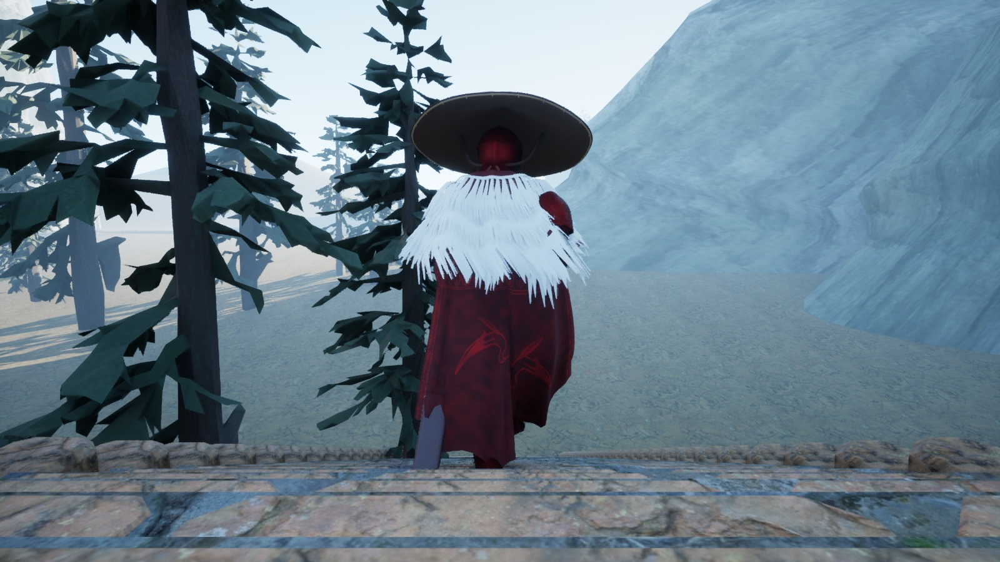
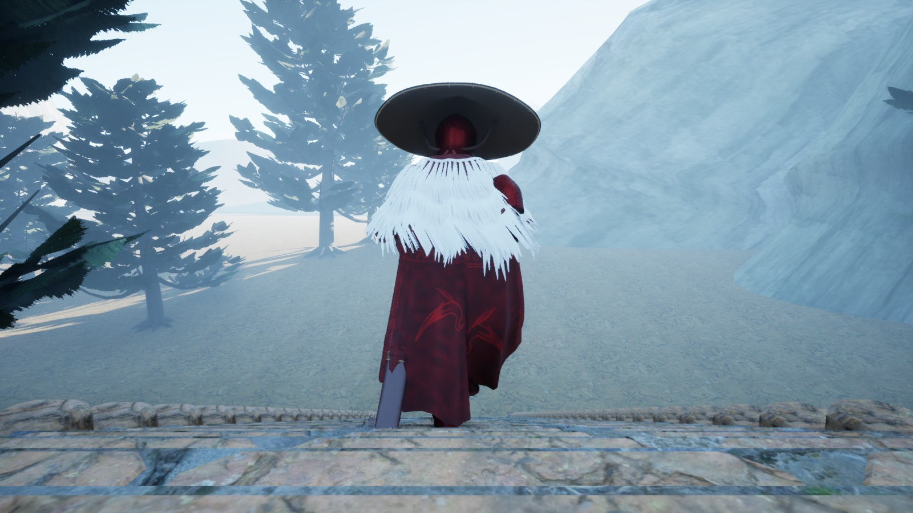
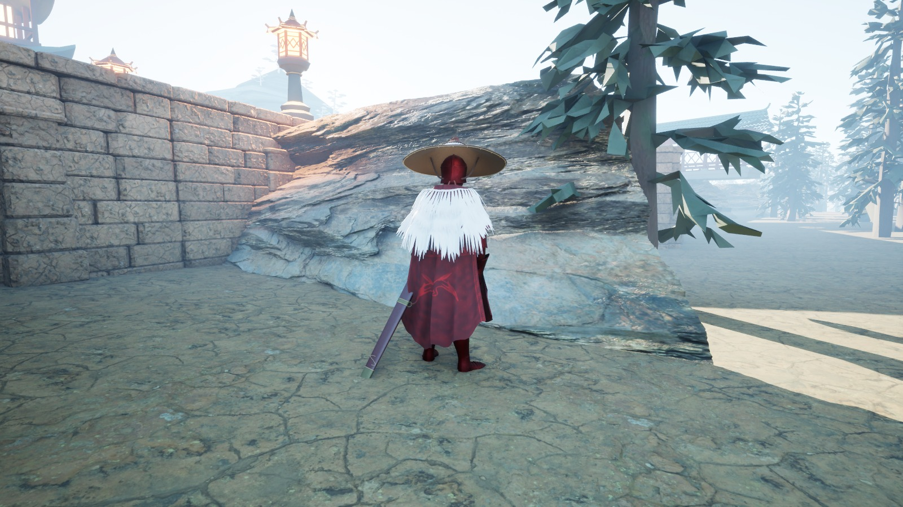
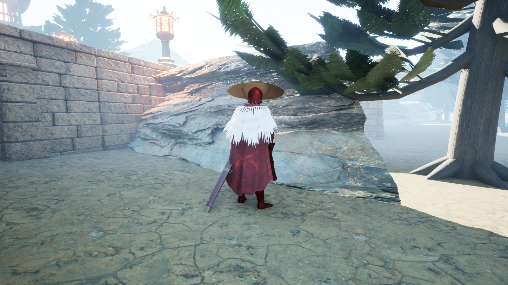

# Pines on the mountain stair

| Camera position | Earlier playable build | New playable build |
| --- | --- | --- |
| Descending the first court stair |  |  |
| Valley bank |  |  |

[View from the foot of the stair](toe.jpg)

These are 1600 × 900 captures from the possessed player in Unreal Engine 5.8.4 on an RTX 5080. Camera headings, route and capture script match the earlier stair run. The valley contains 120 trees, divided equally between two original wind-pruned forms. Each tree uses 26,916 triangles, with solid branch geometry and double-sided masked needle sprays. The roots follow the valley mesh. Trees beside the three stair flights stand back from the centreline to leave room for the third-person camera. The distant ridge treetops belong to a separate environment mesh.

The player ran down and back up the first stair with zero falling-mode samples. After the final screenshot, the probe held the playable camera at the bank and waited one second before measuring game ticks for eight seconds under a 60 fps cap. Across 478 intervals the median was 16.68 ms, the 95th percentile was 17.84 ms and the maximum was 25.47 ms. This is a warmed, stationary forest view. No matching timing sample exists for the earlier tree meshes. Combat performance remains unmeasured in this level.

[Level inventory](trees.json) · [Player movement, camera positions and raw timing samples](route.json)
