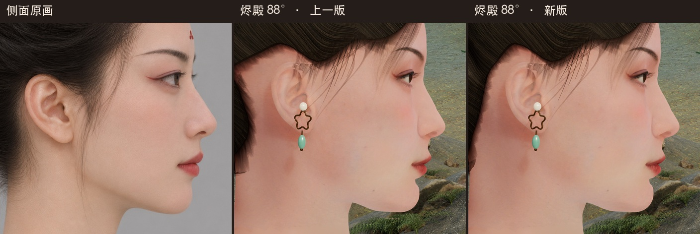
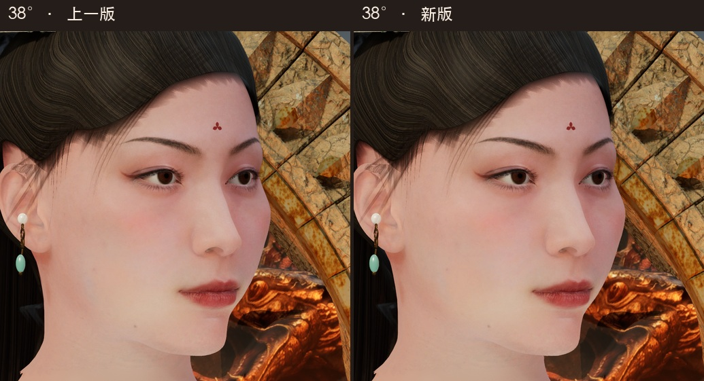
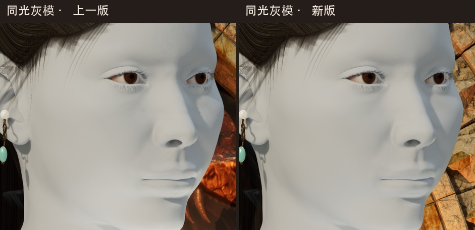
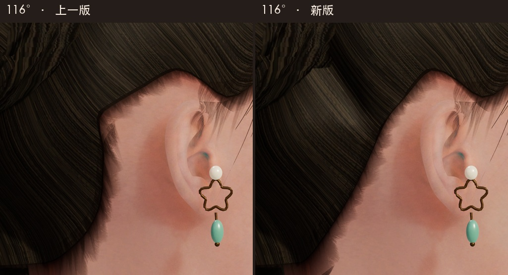

# 海棠 · 烬殿转面里的侧颊与耳后发际

[观看 10.7 秒同机位实机转面](orbit.mp4)。左边是上一版，右边是新版。两段均录自 RTX 5080 上的 Unreal 游戏窗口，海棠使用正式战斗角色。镜头与头骨对齐，最远转到 116°。并排剪辑统一裁切，并按人脸和场景边缘同步两次录制的帧。两次录制中的火焰各自运动。



颧下到口角外侧的软组织形成一段较宽的凸面。改动集中在侧颊，最大向外位移 1.25 毫米、向前 0.65 毫米。下面第一张在烬殿侧光下拍摄。第二张把两版实机角色的皮肤换成同一块中性灰材质，更容易看清颊面的几何转折。两次拍摄中背景和环境反光略有差别。38° 用于检查转面中的体积，原画对照取 88°。





耳廓后方的发壳原先有一段清楚的斜边，向颈后的转向集中在很短的距离内。新版让这段弧线围着头部逐渐转向。短发从同一条弧线根部顺着头皮生长，耳后中段的深色发束拆得更细。



### 同机位读数

在原始 2560 × 1440 截图上沿发际取两条亮度边界，比较相隔 48 像素的图像切线方向。较暗边界的最大转向由 **62.8° 降至 17.2°**，较浅边界由 **76.6° 降至 24.1°**。这是固定镜头下可见轮廓的变化。

侧面参考采用项目内的严格侧面原画。用可见瞳孔和口角对齐 88° 实机图，原画取 21 × 21 像素，实机取 25 × 25 像素，计算各区域的显示色中位数。L* 表示明度，a* 越大越红，b* 越大越黄。原画采用中性背景，烬殿里有侧光与环境反射。

| 侧脸部位 | 原画 | 上一版 | 新版 |
| --- | ---: | ---: | ---: |
| 上颊明度 L* | 72.1 | 68.6 | 71.6 |
| 耳前后颊 a* | 11.5 | 15.9 | 11.8 |
| 下颊明度 L* | 70.1 | 69.1 | 70.2 |
| 下颊 b* | 16.0 | 12.9 | 15.0 |
| 口角外侧明度 L* | 71.0 | 72.6 | 71.6 |

鬓角附近的皮肤在烬殿仍比原画偏红，a* 为 14.5，原画为 11.8。

[完整侧面采样和发际轮廓读数](measurements.json) · [侧面原画](../../../native/Art/Wayfarer/sculpt-profile.jpg)

在已安装的 Windows 项目里，从项目根目录运行这条命令即可复看。连续转面结束后会依次停在正面、38°、88° 和 116°。

```powershell
.\Scripts\play_pilgrimage.ps1 -ShrinePortrait -Turntable
```
