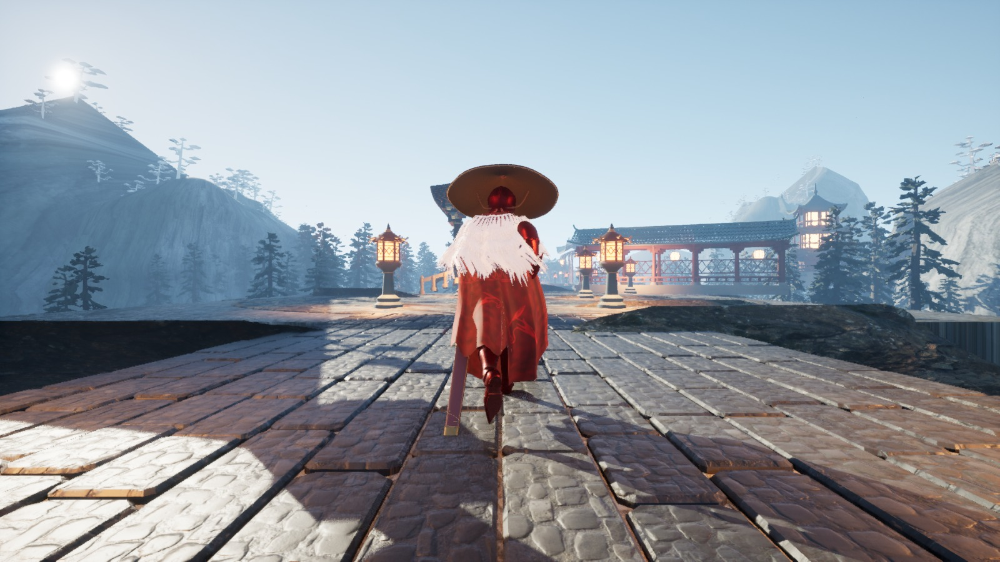

# The pilgrim on the mountain road

[Run footage](mountain-run.mp4) · [Side stride](turning.jpg) · [After stopping](stopped.jpg)

Captured from the possessed player in standalone Unreal Engine 5.8.4 on a Windows RTX 5080 at 1600 × 900. The local locomotion blueprint drives the skinned traveller, silk panels, hat and scabbard together. The outfit combines the credited CC0 armour with Vesper garments. The native route connects three courtyards along 205.4 m of road above a 432 × 432 m valley. Combat remains in the browser build.

The first run supplied 25 engine screenshots. The video scales them to 1280 × 720 and uses their recorded capture times. Readback affects frame pacing. For performance, a separate run in the same warmed session disabled screenshots and sampled the player every game tick for eight seconds. Across 465 wall-clock intervals the median was 16.74 ms, the 95th percentile was 21.08 ms and the longest was 45.88 ms. This measures game ticks on the opening approach. Display presentation, the full valley and boss combat were not benchmarked.

The return covered 31.91 m and peaked at 6.00 m/s. From the first moving sample to full speed took 0.36 s, and from the last full-speed sample to rest took 0.35 s. In the final side run the character turned from 180° to 90° and finished at rest. The foot sockets varied by 33.3 and 40.7 cm relative to the capsule. The side route steps off the causeway.

[Possessed pawn, animation and material slots](appearance.json) · [Capture timestamps and outbound samples](motion.json) · [Uncaptured return](return.json) · [Time, yaw, speed and capsule-relative foot heights](turn.json)
