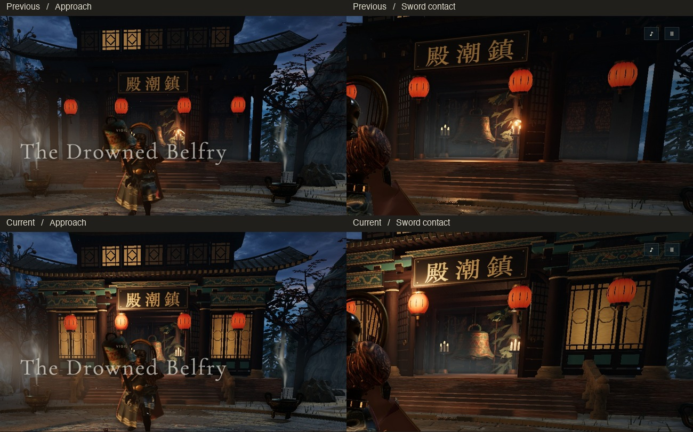

# The painted belfry threshold

The upper row uses `ac2d111` and the lower row uses `aa486fd`. The camera, input and fixed simulation steps match for each pair. Images are crops from 1920 × 1080 gameplay in Chrome on Apple M1 Max. [Full approach](approach.jpg) · [Sword contact](contact.jpg) · [Lateral turn](turn.jpg)

Four projecting timber bracket sets step out from red posts to a line of exposed rafter ends. Paired dragons run along the green beams flanking the existing nameboard. Each side opening is divided into three wood-and-paper screens. The paper has mottled transmitted light, folds and a soft branch silhouette. Lotus-ended stone rails run down the stair alongside the entrance. The central lantern now lights the front timbers from the side, and the altar light picks out the hanging bronze bell inside the hall. The nave remains visible through the open central doorway.

The complete 28-second Pilgrim fight reaches the awakened phase and the victory screen with three parries and full health. Keys were driven automatically. The video keeps the normal camera, combat HUD and stereo game audio. A separate chapter run cleared all three bosses, then a defeat run exercised retries at each court. [Continuous duel](duel.mp4) · [Recorded result](duel.json) · [Three victories](clears.json) · [Defeat and retry](retries.json) · [Playable build CI](https://github.com/lzongren/vesper-hollow-tide/actions/runs/43603898260)

Matched Bellwarden runs on the same M1 Max used separate Chrome sessions with recording disabled. Fight-only 95th percentile callback intervals were 18.2 ms before and 18.2 ms after. Load-to-ready took 1656 ms and 1684 ms respectively. These are one run per revision. [Paired frame timings](frame-comparison.json)
