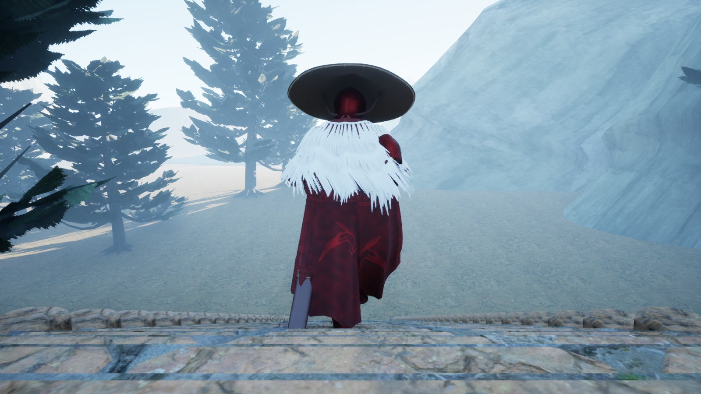
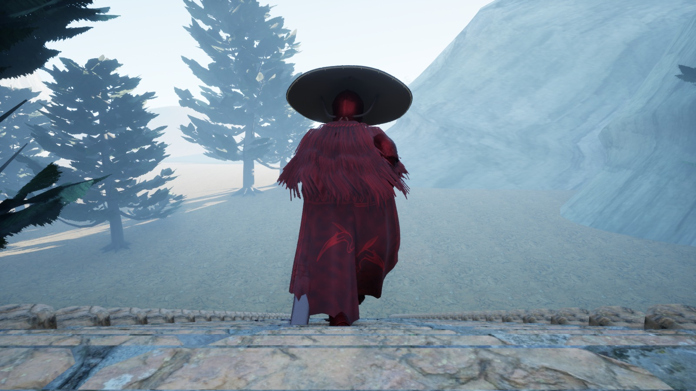

# The pilgrim's knotted palm cape

| First court stair | |
| --- | --- |
| Earlier playable build | New playable build |
|  |  |

[Road approach](road.jpg) · [After climbing back to the court](return.jpg) · [Valley bank](bank.jpg)

The images were captured at 1600 × 900 in standalone Unreal Engine 5.8.4 on an RTX 5080. Both stair views use the same player input, camera heading, valley dressing and lighting. The first run showed a nearly uniform white shoulder piece. In the new run the four overlapping courses, dark recesses, and braided collar remain distinct as the player moves.

The neutral export has 456 individual palm strips and three crossing collar cords. The native bake converts their original vertex colours into a padded 1024 × 1024 atlas, adds longitudinal fibre ridges to the normal map, and varies the roughness between ridges. The fitted mesh uses the same skin weights and locomotion graph. The runtime probe recorded the actual mesh, cape material and animation instance on the possessed player. It completed the first court stair in both directions with zero falling-mode samples. These captures cover movement on the native route; the three boss fights remain in the browser build.

[Runtime player, materials and movement samples](route.json)
