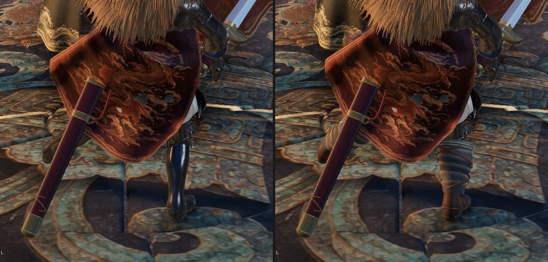

# The pilgrim's travel boots

These are equal-sized crops from the 2560 × 1440 production game in Chrome. Left is revision `0d192ad`. Both runs selected the same encounter, advanced with the same simulation ticks, approached the boss and strafed. The new calf silhouette comes from six individually modelled overlapping linen wraps, two leather straps and a tied cord. The boot leather and sole stitching are shaded in the character's original bind coordinates so they follow the weighted mesh.

[Full Bellwarden frame](bellwarden.jpg) · [Full Heron frame](heron.jpg) · [Full Cinders frame](cinders.jpg)

[Combat movement](combat.mp4) shows the full Heron encounter viewport during lateral movement, dodge and attack inputs. The silent clip shows 105 frames, captured at 1440p, reduced to 1280 × 720 and played at 30 fps. The capture advances two simulation ticks per frame. This documents appearance during motion. The footwork regression test compares ankle trajectories on the actual pilgrim rig with and without the wearables.
