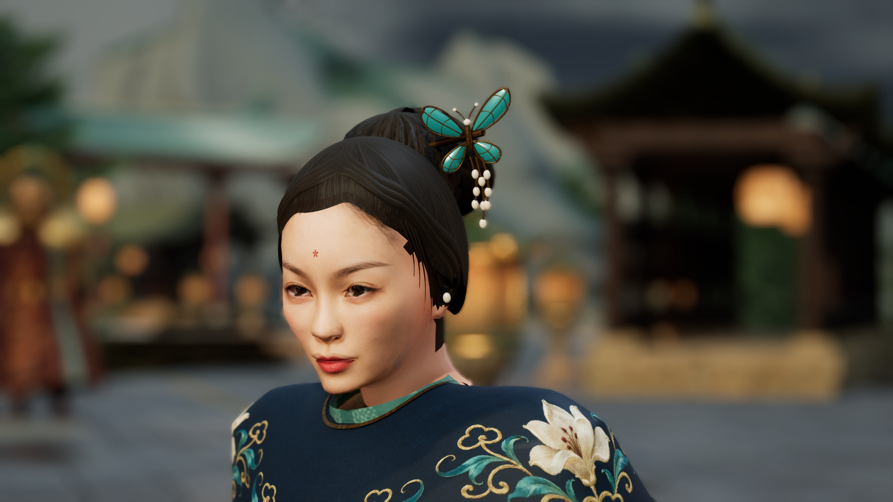

# 梅妆女侠

The playable swordswoman wears a five-petal cinnabar *huadian*, a rose lip tint and a gold-wire butterfly pin with blue-green enamel. Two fine hair panels meet the fitted forehead below the swept chignon. The existing magnolia cloud collar and ivory riding coat move on the combat skeleton.

[Previous fitting](before-portrait.jpg) · [Current fitting](after-portrait.jpg) · [Mid-blink](after-blink.jpg) · [Three-quarter portrait](after-front.jpg) · [Full costume](after-profile.jpg) · [Rear](after-rear.jpg) · [Walking](after-walk.jpg)

The lead image uses a portrait lens and in-engine depth of field. [Portrait camera](../../../native/Scripts/probe_plum_portrait.py)

The comparison probe photographs the possessed pawn in the normal map, with a fixed camera for comparison. The mid-blink frame uses the real idle animation. The face has one bilateral eyelid morph. Her gaze and mouth remain in their resting pose.

## Three-court run

The automated player walked the complete route in a 2560 × 1440 standalone Unreal Editor game on an RTX 5080. It equipped `MeiSwordswoman` and beat the Bellwarden at 22.27 seconds, the Veiled Heron at 59.92 and the Saint of Cinders at 97.51. The video contains three excerpts of that run. The window capture has no audio track. The 21-second edit plays at 1600 × 900 and 30 frames per second.

[Watch the fights](fights.mp4) · [Bellwarden](Bellwarden.jpg) · [Veiled Heron](VeiledHeron.jpg) · [Saint of Cinders](CinderSaint.jpg) · [Recorded route and health samples](three-courts.json)

[Character art and provenance](../../../native/Art/Wayfarer/) · [Repeatable camera positions](../../../native/Scripts/probe_magnolia.py) · [Play the native version](../../../native/README.md)

## Frame times

A second three-victory run used the Unreal CSV Profiler with recording disabled and a 60 FPS cap. Across 6,085 frames, frame time was 16.70 ms at the median, 18.53 ms at P95 and 20.24 ms at P99. Twenty frames exceeded 33.33 ms. The first sample took 460.57 ms and a frame 40.43 seconds into the route took 273.52 ms. GPU time was 5.00 ms at the median and 5.99 ms at P95. [Per-frame counters](frame-times.csv)
