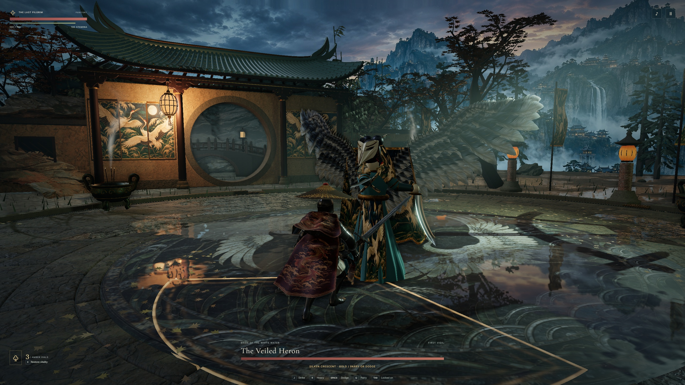

# A lantern at the moon gate

[Complete garden fight with stereo game audio](garden.mp4) · [Same-pose gate comparison](comparison.jpg) · [Opening view](entry.jpg) · [View after circling the Heron](orbit.jpg)

The roof has a shortened ridge, a flared hip at either end and two curved pitches. Six overlapping courses of pan tiles sit below half-round cover tiles. At a low angle the player can see their end caps and the projecting rafters underneath. Four timber columns stand in stone shoes. The two central columns flank the moon opening, so the bridge remains visible as the player moves.

One caged paper lamp hangs under the near eave. The point light in the previous garden stood behind the wall. It now shares the lamp's position and warms the crane panel, bracket ends and rain pooled beneath them. The other side of the porch remains in skylight. The wall in the outer bays still lacks variation, and the distant valley remains a painted panorama. The porch is an original fantasy building for this encounter.

The [native porch GLB](../../../native/Art/MoonGatePorch.glb) reproduces all 54,624 triangles in five material groups and measures 18.39 × 11.10 × 5.46 metres along glTF X, Y and Z. It includes the lamp model. Runtime lighting and the surrounding wall are separate. Import and placement inside Unreal remain pending.

## Capture and verification

The original stills come from the production build on Windows Edge with WebGL 2, an RTX 5080 and a 2560 × 1440 viewport. The earlier and current comparison uses the same inputs, camera, simulation steps and crop. The full-size JPEGs retain the HUD. No retouching or color grading was applied.

The playable bundle on Windows and the local build matched the 61 files in the public CI archive by path and SHA-256. [Build for gameplay revision 2283007](https://github.com/lzongren/vesper-hollow-tide/actions/runs/43587261901)

The Windows tester selected each encounter from the menu, cleared it on Pilgrim using keyboard actions, then ran a separate Penitent defeat and verified full health on retry. The M1 Max check opened all three courts in arm64 Chrome at 1440 × 900, approached, struck, paused and returned to the menu. [Victories](victories.json) · [Defeats](defeats.json) · [M1 Max readback](mac.json)

| Encounter | Clear time | Combat callback p95 | Longest combat callback interval |
| --- | ---: | ---: | ---: |
| The Bellwarden | 0:26 | 16.9 ms | 1.59 s |
| The Veiled Heron | 0:27 | 16.8 ms | 1.53 s |
| Saint of Cinders | 0:43 | 16.8 ms | 2.24 s |

The timings cover one unrecorded run per encounter. The garden still stalled visibly during combat.

A second Pilgrim run circled the Heron twice during combat and recorded 757 timestamped frames in 45.31 seconds. The 1600 × 900 capture includes the awakening, the final knockdown and the victory screen. The game clock shows 24 seconds, four parries and one hit taken. The recording includes real-time stalls and the screencast's lower sampling rate. [Watch the fight](garden.mp4)

A separate instrumented garden run used asynchronous WebGL timer queries around animation callbacks that submitted actual draws. Of 1,572 resolved samples, the median GPU interval was 4.72 ms, the 95th percentile was 6.24 ms and the maximum was 359.23 ms. There were zero disjoint events. The longest browser long-animation frame during combat measured 2.81 s. GPU intervals in the samples directly before and after this gap measured 11.65 and 12.47 ms. This measurement does not assign the intervening time to the driver, browser or operating system. [Timing trace](profile.json)
