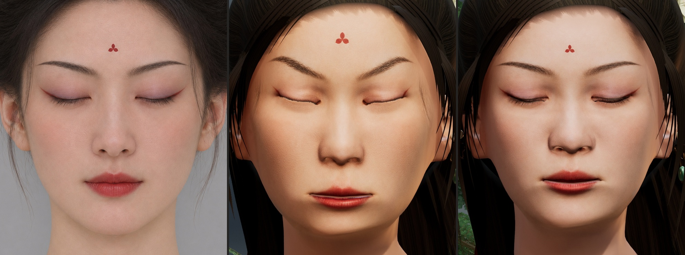
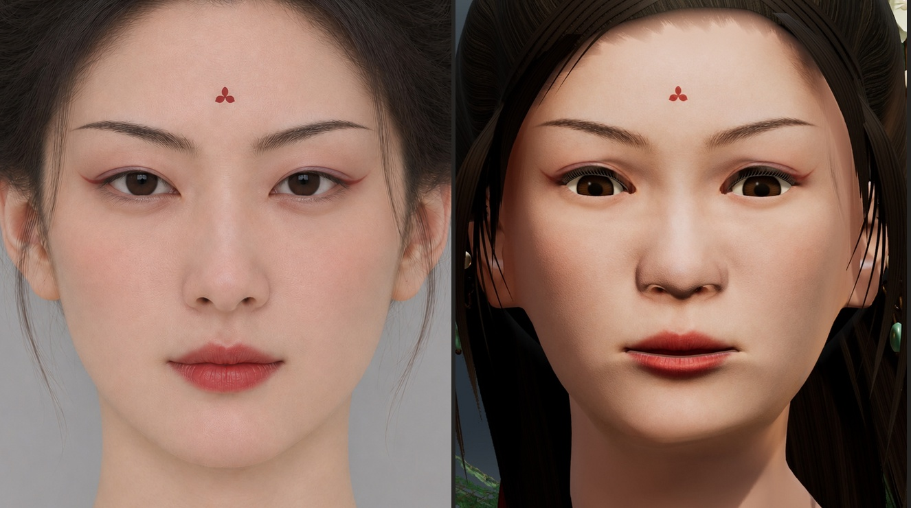

# 海棠的设定图与实机脸部对照

左图是美术设定。中图是旧版 ShuanghuaHaitang，右图是新版 ZhaoyueHaitang。两张游戏图都摄自 RTX 5080 上实际运行的 Unreal 山路场景，使用相同位置、环境光照和 14° 水平视场。镜头朝向跟随头部骨骼，与脸相距约两米。对照只统一外眼角的位置、比例和旋转，然后等比例裁切。

睁眼辅助图由原设定图局部编辑而来。眼球和睫毛由角色自身的几何体绘制。眼球随视线转动，眼皮闭合时，局部皮肤颜色与眨眼骨骼网格形变一起过渡。原始游戏截图保留了庭院光照、头部动作与远处场景。

| 视角 | 旧版实机 | 新版实机 |
| --- | --- | --- |
| 正面闭眼 | [原图](before-closed.jpg) | [原图](after-closed.jpg) |
| 正面睁眼 | [原图](before-open.jpg) | [原图](after-open.jpg) |
| 转过 34° | [原图](before-turn.jpg) | [原图](after-turn.jpg) |

## 形体拟合与检查

用正面照和旧版实机图估计连续的脸部位移，施加在蒙皮网格上，第一轮闭眼和睁眼的 [校准截图](calibration/) 用于二次校正。离线推算的面部深度变化限制在 5 毫米内。后脑和颈部接缝固定。正面参考无法确定鼻尖的侧面突出量或颊骨的真实深度。

从正面闭眼图提取眼角、鼻翼、嘴角、下巴和面颊等位置。用两个外眼角对齐，再用未直接参与拟合的另十六个点计算平均平面距离，除以原图外眼角间距。相邻点仍相关，数字只衡量这一次正面投影。旧版平均偏差为眼角间距的 6.46%，新版为 1.52%。换算回 1254 像素参考图，鼻尖从低约 34 像素变为高约 10 像素，唇线从低约 44 像素变为高约 10 像素。下巴仍偏高约 21 像素，睁眼时眼神较紧，鼻翼阴影也比设定图硬。逐项数据见 [测量结果](landmark-check.json)。

## 战斗复测

用同一角色依次通过三个庭院。回放脚本驱动角色走路、出剑和闪避，并读取实际生命值。[守钟人](Bellwarden.jpg) · [披纱鹭](VeiledHeron.jpg) · [灰烬圣徒](CinderSaint.jpg) · [运行记录](three-courts.json)
