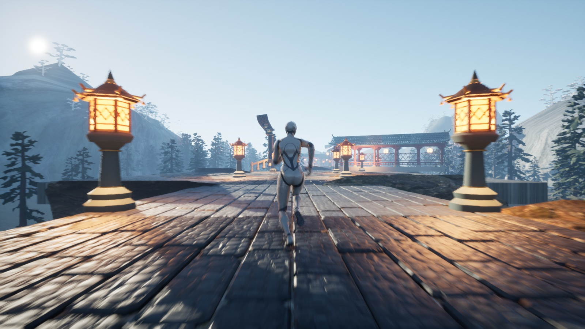

# Approach to the belfry

[Unreal gameplay clip](approach.mp4) · [Earlier run on the same road](../mountain-pilgrimage/running.jpg) · [Capture timing and player position](outbound.json) · [Return-trip samples](return.json)

The five road sections contain 26 stretches of cut grey stone and 27 votive lanterns. Each stretch has 117 individually bevelled stones, staggered joints and embedded scanned color and normal maps. The stone uses the repository's [CC0 cobblestone scan](../../imported-assets.json). Brass lattice and bells surround the lantern's lit silk insert. Cool directional light and height fog separate the belfry and mountains from the warm light beside the player.

Unreal 5.8.4 ran in standalone game mode on the RTX 5080 at 1600 × 900. The clip uses 38 engine screenshots placed at their actual sampling times, scaled to 1280 × 720. PNG readback slows the capture. The same game session then ran back down the approach with capture disabled. Over 457 wall-clock intervals, the median was 17.17 ms, the 95th percentile was 21.22 ms and the longest was 31.81 ms. The character covered 31.80 metres, peaked at 6 m/s and ended at rest. This sample covers the warmed-up opening route.

The player still uses the template mannequin and locomotion. The three combat encounters are playable in the browser build.
