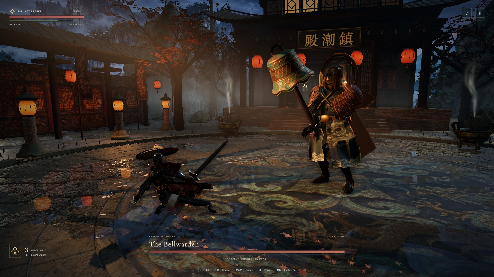

# The pilgrim's evasive step

[Three evasions in combat with stereo game audio](quickstep.mp4) · [Belfry sidestep](belfry-comparison.jpg) · [Garden advance](garden-comparison.jpg) · [Shrine retreat](shrine-comparison.jpg) · [Retreat camera study](retreat-camera.jpg)

During an evade, the pilgrim lowers the hips, reaches with the leading boot and draws the trailing leg up. The body leans into the input direction, then shifts its weight onto the landing foot. The sword comes in close while the free arm balances the turn. The leading ankle drives a footfall and a ripple where it lands. Contact shading under both fighters follows the heel and forefoot separately as either end of the foot lifts. When the pilgrim retreats towards the camera its follow speed increases, keeping the landing in frame.

The paired frames were taken in arm64 Chrome on an M1 Max at a 1920 × 1080 viewport. Both rows use identical input and simulation steps on Penitent. The film uses separate real-time Pilgrim runs in the same three courts. The player walks forward, evades, then attacks. Each evade spent 23 stamina. The left, forward and backward controls were A, W and S with Space. The camera study isolates the tracking change with the new pose present on both sides. [Input and GPU readbacks](inputs.json) · [Garden full frame](garden.jpg) · [Shrine full frame](shrine.jpg)

The simulation still advances the dash for the first 0.32 s of its 0.47 s action. The landing animation follows that schedule. A test exercises the actual pilgrim leg hierarchy at 30, 60 and 120 Hz and checks that only one contact fires, that the leading foot is grounded ahead of the trailing boot and that ordinary footwork can resume. [Build and test run](https://github.com/lzongren/vesper-hollow-tide/actions/runs/43595638185)

The reel shows the three courts in order, with the original compositor timestamps and 48 kHz stereo game output. The source captured 58, 72 and 33 frames across the three excerpts. The 30 fps encoded file repeats frames where the compositor delivered fewer. The shrine excerpt is visibly less smooth than the belfry and garden. Each evasion also has full-resolution matched stills above.

The downloadable CI archive matched all 64 production files in the tested local build. Extract the archive, run `python3 -m http.server 8000 --bind 127.0.0.1` in the directory containing index.html and open `http://127.0.0.1:8000/`. [Packaged build](https://github.com/lzongren/vesper-hollow-tide/actions/runs/43595638185/artifacts/14114106329)

One M1 Max Pilgrim run cleared all three awakened bosses in chapter order and reached the chapter ending. The Penitent retry driver reached zero health in each court, retried and waited for a new 100 / 100 health reading. [Victory records](clears.json) · [Defeat and retry records](retries.json)
