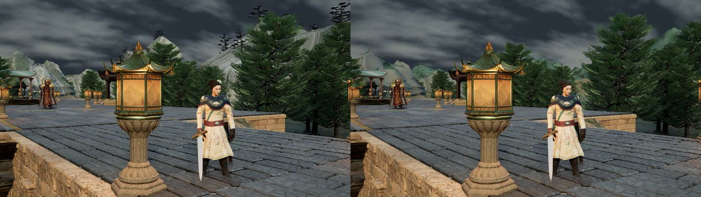

# Xingping skyline

The road now sits inside a scaled Li River valley height field. The six old distant ridge and tree actors are hidden, while the shrine's nearer rock spurs use a world-aligned limestone material. The existing road, stairs and combat collision remain in place.

The possessed player's camera was placed at the same positions in two 2560 × 1440 standalone Unreal Editor sessions on the RTX 5080. Each image below is a full game frame. A separate [diagnostic frame](before-isolated.jpg) temporarily hides the old ridge actors from the road camera. The shrine lookout shows the remaining low-detail ledges in front of the measured peaks.

| Camera | Previous | Revised |
| --- | --- | --- |
| Procession road | [Before](before-road.jpg) | [After](after-road.jpg) |
| Gallery roofline | [Before](before-north.jpg) | [After](after-north.jpg) |
| Shrine lookout | [Before](before-south.jpg) | [After](after-south.jpg) |

[Source data and attribution](../../../native/Art/RiverPeaks/README.md) · [Camera positions](../../../native/Scripts/probe_ridge.py) · [Playable swordswoman and combat footage](../plum-wayfarer/)
