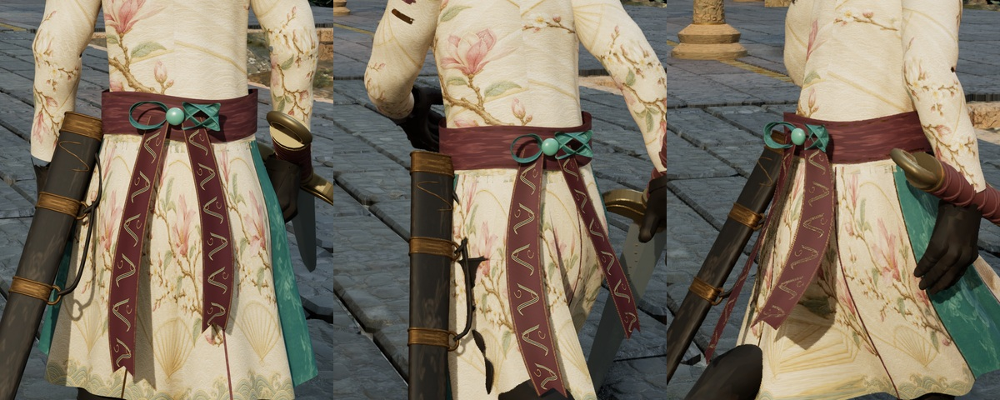

# The swordswoman’s river sash

A jade clasp and a folded celadon knot anchor two plum brocade streamers of different lengths. The [embroidered river pattern](../../../native/Art/Wayfarer/river-sash.jpg) follows each strip through its twist and forked hem.

The [16-second game-window capture](movement.mp4) follows the possessed pawn from rest into a run, through a 65-degree turn and back to rest. The silent 1280 × 720 recording retains the capture timestamps. The [standing](rest.jpg), [running](run.jpg) and [turning](turn.jpg) frames were taken in a separate 2560 × 1440 Unreal standalone session on the RTX 5080.

The material anchors each ribbon at the knot and bends progressively towards its tip. A damped spring responds to the pawn’s velocity and turn rate. The [material parameter samples](motion.json) record world-space tip displacement in centimetres. Skirt collision and wind are outside this model. The [camera and movement script](../../../native/Scripts/probe_streamers.py) reproduces the sequence.

In the [three-court trial](three-courts.json), the same pawn defeated the Bellwarden, Veiled Heron and Saint of Cinders in 100.60 seconds from spawn. Across [5,873 engine frames](frame-times.csv) at 1440p, median frame time was 16.67 ms and P95 was 18.60 ms. Ten frames exceeded 33.33 ms. The longest took 288.77 ms.
