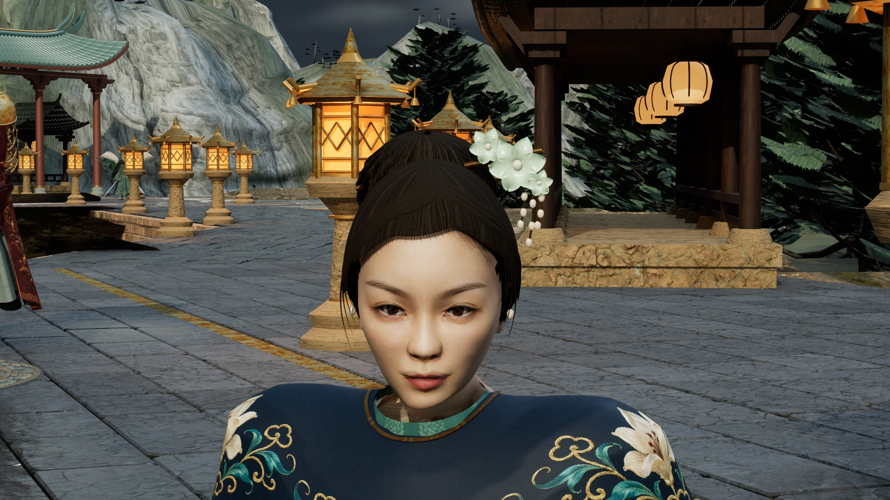
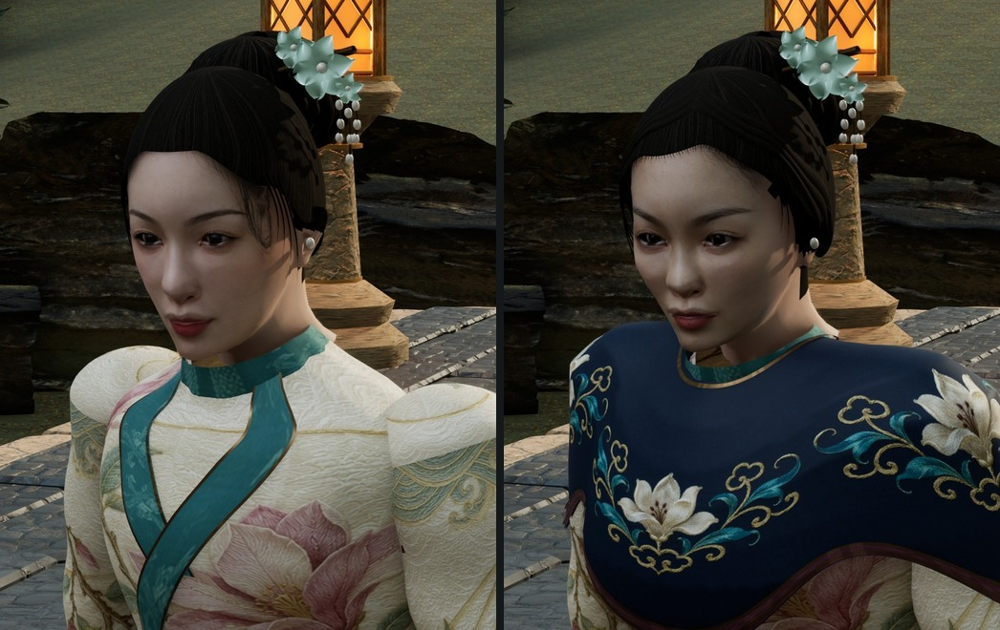

# 玉兰女侠 · The Magnolia Swordswoman

The playable Unreal character wears a swept chignon, a jade magnolia comb with pearl drops, and a four-lobed embroidered cloud collar over an ivory riding coat. Each lobe crosses from the chest onto the moving shoulder. The head uses an original portrait projected over the fitted face, with a separate eye surface and a second UV channel that fades the facial colour into the skin at the temples and under the chin.

The [portrait probe](../../../native/Scripts/probe_magnolia.py) photographs the possessed pawn on the route. The [previous fitting](../magnolia-tailoring/front.jpg) and [new fitting](front.jpg) use the same position, camera and lighting. The portrait above turns her into the existing courtyard light. The [side](profile.jpg), [rear](rear.jpg) and [walking](walk.jpg) frames show the garment in the game.

The [combat frame](duel.jpg) uses the ordinary third-person camera and HUD. The [route trace](three-courts.json) records the equipped mesh, actor health and victories during the automated 2560 × 1440 standalone Unreal Editor run on an RTX 5080.

[Facial and embroidery sources](../../../native/Art/Wayfarer/README.md) · [Launch the native game](../../../native/README.md)
