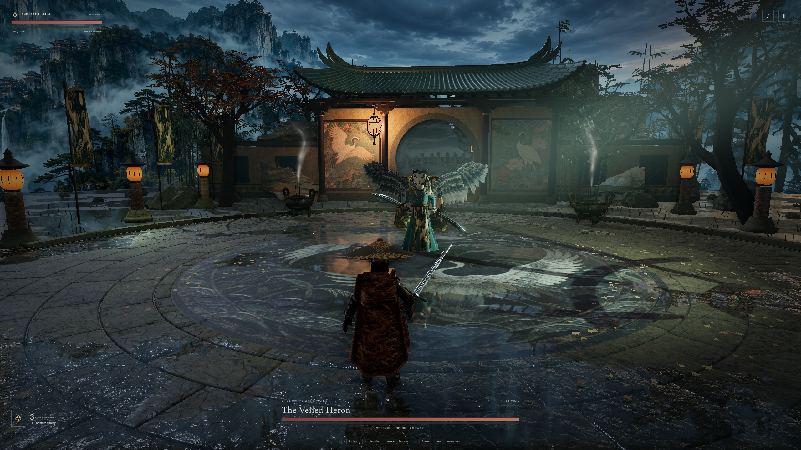

# The painted crane court

[Earlier and current entry view](entry-comparison.jpg) · [Attack poses from the same camera](comparison.jpg) · [Full fight with game audio](duel.mp4)

One crane lands among pine branches while its partner stands among peonies. The porch lamp lights their two plaster panels unevenly. Timber reveals, stone sills and the row of lozenges below the outer windows cast shadows in the rain. The crane texture loads on the first garden visit. [Paint atlas and provenance](../../ASSETS.md#crane-paintings-for-the-moon-gate)

The Heron's hands curl over separately bound hilts. The edge and the hollow channel on each side of the blade catch the skylight as the wrist turns. The quill near the guard is brass wire geometry. Each arm has its own targets during preparation, attack and recovery. The skirt's edging and embroidered front follow the turn at the waist. [Hand and blade crop](grip.jpg) · [Crossing view](crossing.jpg) · [Animated weapon GLB](../../../native/Art/HeronSabres.glb)

## Silken crescent

The camera, character inputs and simulation steps are matched to the previous production build. Counting from the first gold warning at 60 simulation steps per second, the shots show preparation at step 29, the final warning at 46, the cut at 51 and the opening at 75. The HUD changed from 100 to 79 health on step 48 and announced the opening on step 64. The player holds position after step 29. Melee damage still uses the encounter's sector test. At the closest camera angle the pilgrim's hat overlaps part of the attacking arm. [Preparation](gather.jpg) · [Last warning](edge.jpg) · [Cut](cut.jpg) · [Opening](recover.jpg) · [HUD changes](timing.json)

## Runtime verification

The full-size stills were captured at 2560 × 1440 on Windows Edge using the RTX 5080. Both comparison sheets use the same crop on both sides. The gallery retains the original colors and HUD. The distant mountains remain a painted panorama.

The Windows production bundle and the local preview matched all 62 files of the Linux CI web archive by path and SHA-256. The CI jobs built the web game and ran its 37 tests on Linux and macOS, and ran eight native source-tool tests on Windows and Linux. [CI for gameplay revision 8860b1b](https://github.com/lzongren/vesper-hollow-tide/actions/runs/43588903373)

Apple Silicon verification used arm64 Chrome and the M1 Max Metal renderer at 1440 × 900. In each court the player moved, struck, paused and returned to encounter selection. [Mac HUD readback](mac.json)

Windows gameplay checks took all three bosses through their awakened phase and onto their victory screens using the Pilgrim difficulty and ordinary keyboard input. A separate Penitent run checked defeat, retry and restoration to full health for each boss. [Victory readbacks](victories.json) · [Defeat readbacks](defeats.json)

| Encounter | Clear time on HUD | Combat callback p95 | Longest combat callback interval |
| --- | ---: | ---: | ---: |
| The Bellwarden | 0:27 | 16.9 ms | 1.86 s |
| The Veiled Heron | 0:27 | 16.8 ms | 2.12 s |
| Saint of Cinders | 0:44 | 16.9 ms | 1.90 s |

Each figure covers one unrecorded clear. The two-second gap in the garden remains visible in motion.

The separate recorded run includes 835 timestamped frames at 1600 × 900 and 48 kHz stereo game audio. The clip lasts 50.55 seconds. The final HUD reports 28 seconds of combat, five parries and zero hits taken. [Watch the fight](duel.mp4)
