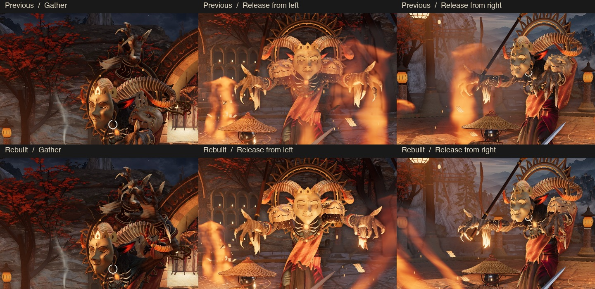

# Falling Prayers in motion

The top row uses the previous gameplay revision `a5000e9`, and the lower row uses `c40e07a`. Both ran on the same RTX 5080 in Windows Edge at 2560 × 1440. Each column uses the same crop, inputs, camera and simulation tick. At release, the player has 18 health on both builds on both approaches. [Gather](gather.jpg) · [Left approach](left.jpg) · [Right approach](right.jpg)

The saint draws the left hand above the mandorla, turns the palm out during the delayed warning and closes the fingers as the marked vent lights. Upper plumes and ash bend away from the summoner; the floor marks and damage radii stay fixed. The beads and tassel swing from the cuff during the turn. From the side the highest fingers still cross the bronze crown. [1080p in-game movement, 4.5 seconds, silent](crossing.mp4)

The separate real-time campaign run cleared all three awakened bosses on Pilgrim at 2560 × 1440. The intervals below describe browser animation callbacks during fights. The film samples every second simulation tick and does not supply these timings. [Complete results](clears.json)

| Encounter | Health at victory | Combat p95 | Longest interval |
| --- | ---: | ---: | ---: |
| The Bellwarden | 100 | 16.8 ms | 19.7 ms |
| The Veiled Heron | 100 | 16.8 ms | 24.3 ms |
| Saint of Cinders | 75 | 16.8 ms | 54.8 ms |

All 82 published build files matched the local and Windows runtimes by SHA-256. The Linux and macOS game builds and Windows and Linux source-tool checks passed. The separately exported native clip includes 226 samples on three arm bones and the finger morph channel. Native editor playback remains pending. [CI results](https://github.com/lzongren/vesper-hollow-tide/actions/runs/43611302565) · [Native clip](../../../native/Art/CinderSealCast.glb)
