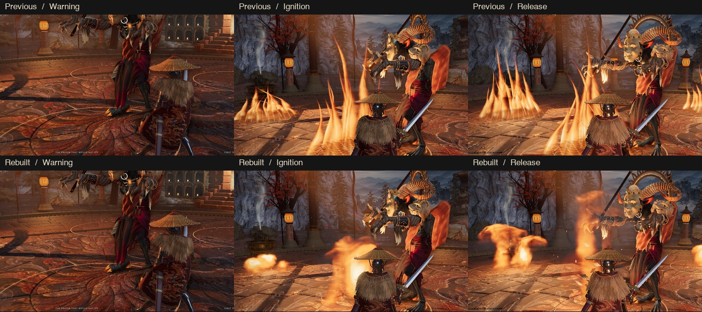

# Falling prayers in the Ashen Reliquary

The top row uses `786e820` and the lower row uses `ec1794d`. The same approach, sideways step and 60 Hz simulation inputs provoke the third boss’s normal Falling Prayers attack. The production game rendered each frame at 1920 × 1080 in Chrome on an Apple M1 Max. Both runs finished the capture at 18 health. [Warning](warning.jpg) · [Ignition](ignition.jpg) · [Release](release.jpg) · [Last embers](embers.jpg)

Each vent reads one of two buoyant smoke and heat simulations. Three staggered sources feed a plume, pressure pushes its head sideways and cooler soot rises above the bright core. Fourteen depth-tested slices reconstruct the volume from the gameplay camera and the wet pavement’s reflection camera. Glowing fissures appear during the final part of the warning. Small scraps roll in the updraft and darken from their edges. The damage radius and activation schedule come from the original encounter.

The volume uses two channels, heat and soot, packed into a gzip-compressed RG8 texture. The game requests it when entering the shrine. The bake has 16 time samples per variation. To regenerate it, run `python3 art/bake_shrine_fire.py` with NumPy installed. The synthesized ignition includes a short low gust and intermittent paper crackle. Each source is panned relative to the current camera and attenuated by distance from the player.

The 49.8-second Pilgrim recording uses automated keyboard input, normal combat UI and stereo game audio. It reaches the awakened phase and victory, with 82 health remaining. [Complete fight](duel.mp4) · [Recorded result](duel.json) · [Playable build CI](https://github.com/lzongren/vesper-hollow-tide/actions/runs/43608019937)

A separate chapter run cleared all three bosses in sequence. [Encounter outcomes and frame intervals](clears.json)

## Windows gameplay capture

The same CI build ran in Edge on a GeForce RTX 5080 using Direct3D 11 at a drawing-buffer size of 2560 × 1440. Each of three separate six-second combat samples recorded 360 browser animation callbacks with a 16.8 ms 95th percentile. These intervals measure callback delivery over the sampled opening exchanges. The complete duel and three victories above were recorded on the M1 Max. [Windows frame intervals and adapter](rtx5080/measurements.json)

[The Bellwarden](rtx5080/rtx-lotus.jpg) · [The Veiled Heron](rtx5080/rtx-plume.jpg) · [Saint of Cinders](rtx5080/rtx-cinder.jpg) · [Falling Prayers at release](rtx5080/release.jpg)
