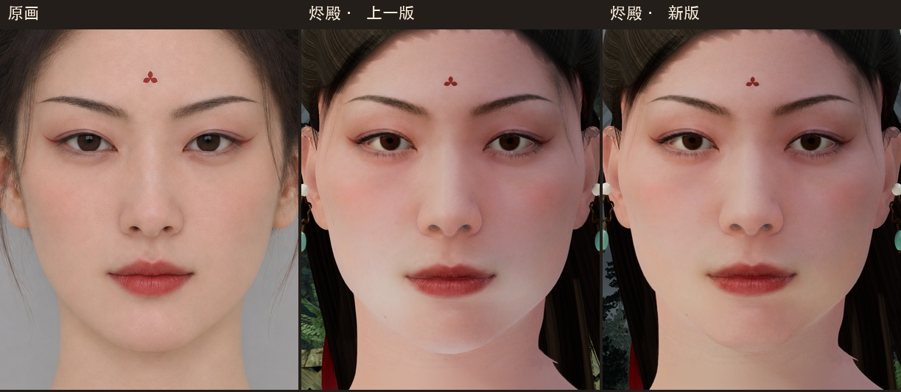
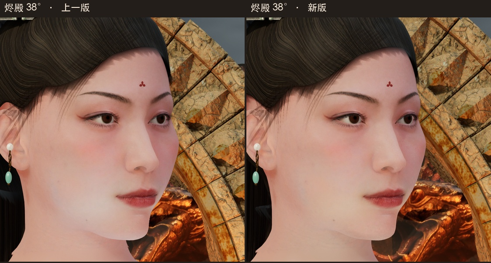
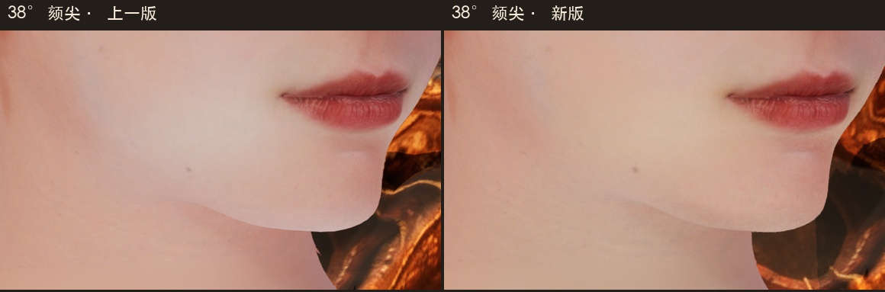
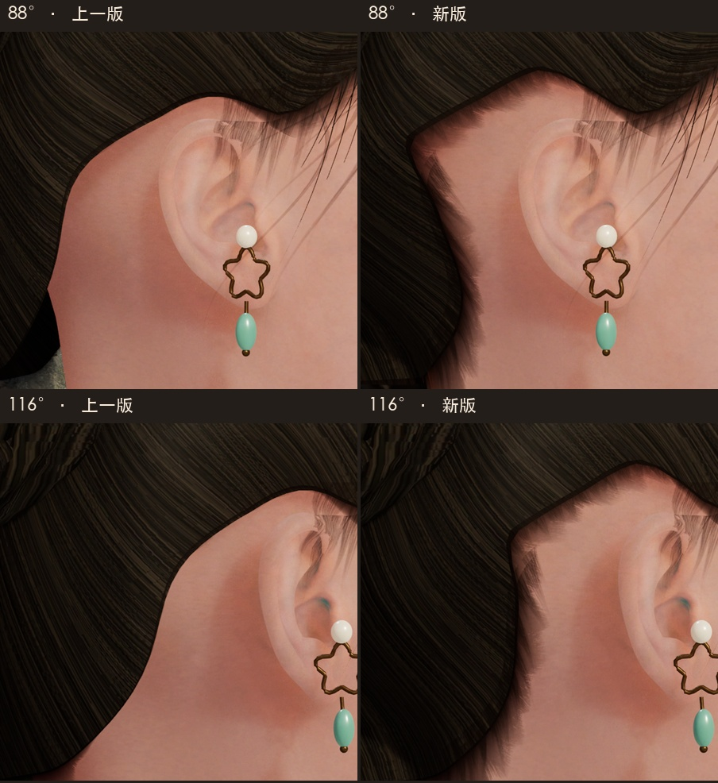

# 海棠 · 烬殿侧光下的面部与发际

[两版同步实机转面（10.7 秒）](orbit.mp4)。左侧是上一版，右侧是新版。两段均来自 RTX 5080 的 Unreal 独立游戏窗口。海棠站在烬殿前的同一位置，镜头与动画头骨对齐，水平视场角为 14°，最深的后斜视角为 116°。并排录像按场景与脸部边缘对齐了实拍帧，使用相同裁切与比例。火焰和环境动画各自运行。



口角外侧的软组织往前补了至多约 0.9 毫米，正面宽度沿用原来的校准。颧下肤色回暖，向下颊自然减淡。烬殿侧光下颏尖的窄亮边来自朝向衣领的皮肤。沿实际下巴曲面调整反射色，保留了向前一侧的颏垫。





逐块隐藏皮肤表面后，能看出颏下同时露出了扫描头模的下缘和连接锁骨的颈面。两块网格现在按同一套人体坐标给顶点着色，颜色随动作和各自的骨骼权重一起走。第一轮只在头部贴图上去红，出现了一条黄绿接缝，这个方案已由跨网格的校色取代。

耳后发根依发流接在实心发壳边缘。靠近耳上缘的一小段让出空间，用长短不同的短发做从头皮到浓发的过渡。下面两组分别是 88° 侧面和 116° 后斜面。



### 同机位皮肤采样

| 部位与读数 | 原画 | 上一版 | 新版 |
| --- | ---: | ---: | ---: |
| 烬殿 38° 颏尖边缘的黄蓝值 b* | — | 7.1 | 13.2 |
| 烬殿颏底下方 0.08 瞳距的红绿值 a* | 11.5 | 15.1 | 11.3 |
| 钟楼颏底下方 0.08 瞳距的红绿值 a* | 11.5 | 18.6 | 14.5 |
| 钟楼颏底下方 0.13 瞳距的红绿值 a* | 12.7 | 19.7 | 14.6 |
| 钟楼下颊的黄蓝值 b* | 15.0 | 10.5 | 14.3 |

烬殿 38° 颏缘相对上方颏面的明度差，从 4.0 降至 0.6 L*。116° 极近景仍能辨出发壳从斜向转向颈后的折角。

正面按双瞳配准。颏底从中央亮度下降处定位，再按瞳距向下取样。38° 的颏缘只取轮廓以内的皮肤，原画只有正面对照。a* 越高越红，b* 越高越黄。这些是特定场景光照下的显示色。[完整 CIELAB 读数](samples.json)

在已安装的 Windows 项目中运行以下命令，可以用同样的镜头直接检查转面。转面结束后镜头依次停在正面、38°、88° 和 116°。

```powershell
.\Scripts\play_pilgrimage.ps1 -ShrinePortrait -Turntable
```
