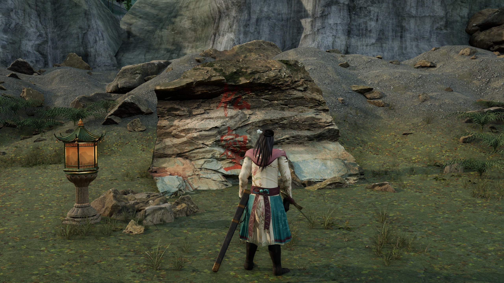
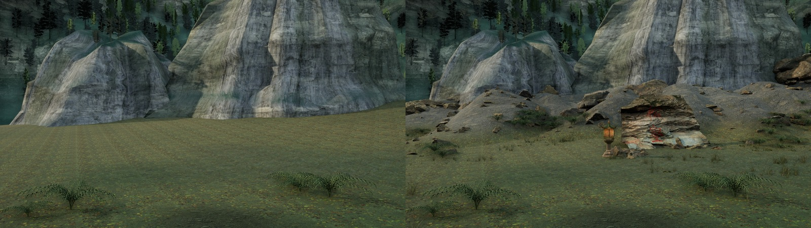

# 松壑 · 灰烬祠南阶

从第三庭灰烬祠的南阶下山，走到小灯旁，可以看到岩面上的「松壑」。朱砂沿原石裂纹断开，字口的法线有浅浅的凹陷。崖脚的坡面沿八处山体轮廓展开，向外渐薄，底部延续谷地原有的草土、针叶和湿石材质。落石聚在坡上，草丛、蕨和蒲公英长在较缓的坡脚。灯和题字是为这条虚构的山路设计的。

| 实机机位 | 改前 | 改后 |
| --- | --- | --- |
| 崖底 | [山体与草地](before-foot.jpg) | [碎石坡、草丛和题刻](after-foot.jpg) |
| 祠前远景 | [山脊](before-ridge.jpg) | [山脊与坡脚](after-ridge.jpg) |
| 廊外 | [谷地](before-garden.jpg) | [林下碎石](after-garden.jpg) |

[石刻近景](after-inscription.jpg) · [海棠女侠下阶的实机录像](ravine-walk.mp4) · [步行轨迹](walk.json) · [素材来源、许可和重建方法](../../../native/Art/ShrineTalus/)

## 实机检查

截图取自 RTX 5080 上运行的 Unreal Engine 5.8.4 独立游戏窗口，分辨率为 2560 × 1440。步行测试用游戏移动输入走完两个路点。10.8 秒的随行镜头节选保留同次运行的引擎立体声混音，收听位置固定在海棠身上。草叶上端的风动幅度较大，根部保留原位。石刻、灯、坡面及植被也出现在普通游戏中。

重新打开已保存的关卡后，查到 3,791 个落石、1,329 株蕨、2,676 丛草和 337 株蒲公英。实机垂直探线有 129 条命中坡面网格，侧向探线命中题字石。[碰撞与实例记录](survey.json) · [检查脚本](../../../native/Scripts/probe_scree.py)

在独立的一趟步行测试中关闭录像和截图，帧率上限为 60。1,275 帧的帧时间中位数为 16.67 毫秒，P95 为 19.01 毫秒，P99 为 21.17 毫秒。超过 33.33 毫秒的只有首帧，耗时 264.12 毫秒。GPU 时间中位数为 4.72 毫秒。[逐帧 CSV](walk-frame-times.csv)

同一版地形上，海棠女侠从起点出发，在 23.26 秒击败守钟人、60.44 秒击败披纱鹭、104.78 秒击败灰烬圣徒。[守钟人](Bellwarden.jpg) · [披纱鹭](VeiledHeron.jpg) · [灰烬圣徒](CinderSaint.jpg) · [通关记录](three-courts.json)
