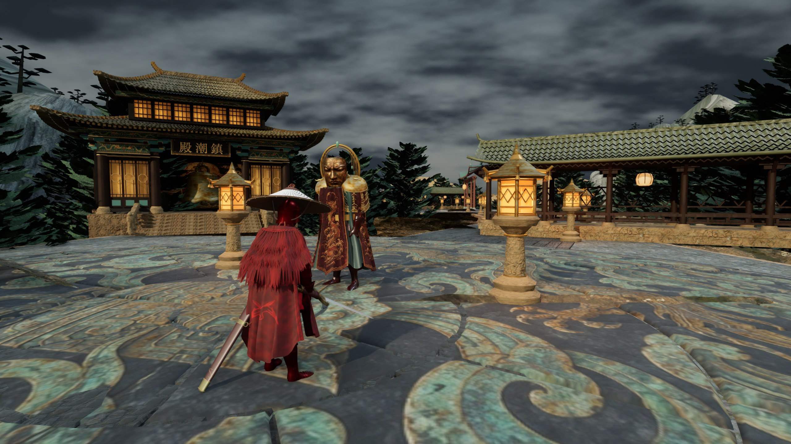
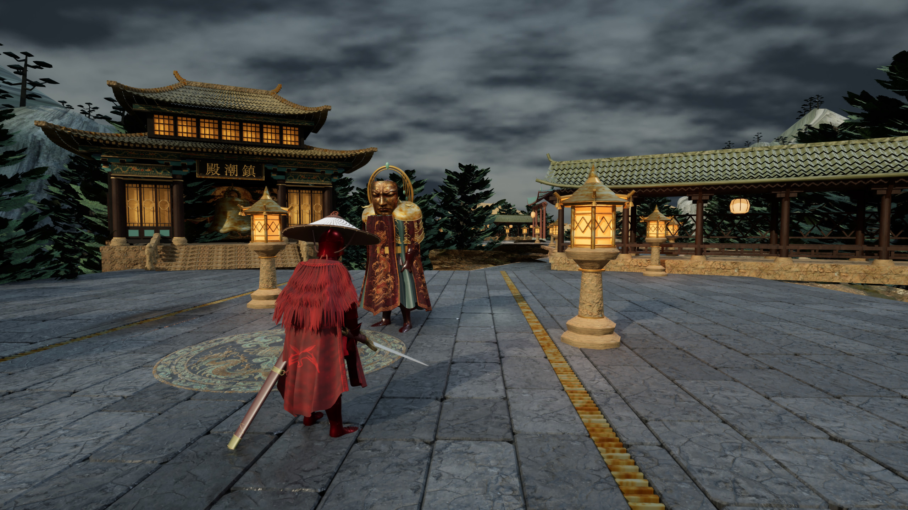

# Bellwarden’s stone forecourt

| Previous paving | Dressed slate |
| --- | --- |
|  |  |

Both approach frames use the same player position and camera rotation in the native game at 2560 × 1440. The forecourt contains 756 individually bevelled stones. A pair of drains flanks the processional lane. Per-stone texture offsets break up the scanned rock grain, while vertex colours vary the tone and the surface response around damp patches. A 3.55-metre seal marks the centre of the fight. The floor and navigation used by the encounter remain in place under the visible masonry.

The [fight](contact.jpg) and [cleared courtyard](court.jpg) were captured in Unreal 5.8.4 standalone editor game mode on a Windows RTX 5080 using Direct3D 12. The diagnostic moved the possessed player and sent attack and dodge inputs against the live Bellwarden AI. The [sampled encounter trace](trial.json) records health, state, timing and the first observed victory. Frame intervals include synchronous screenshot readbacks under a 60 FPS cap.
