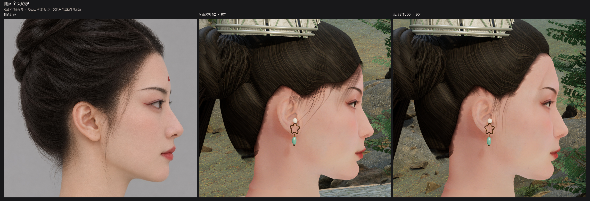
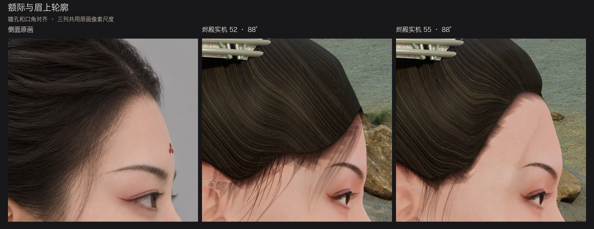
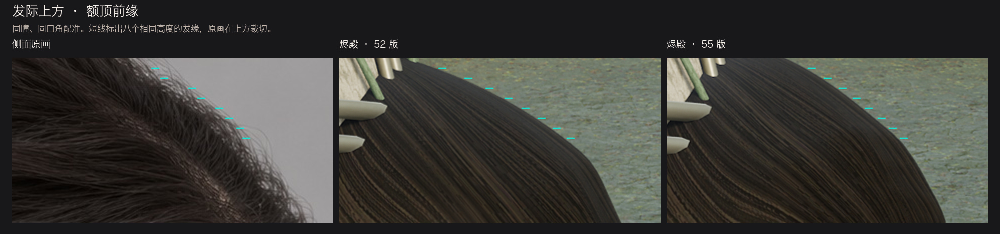
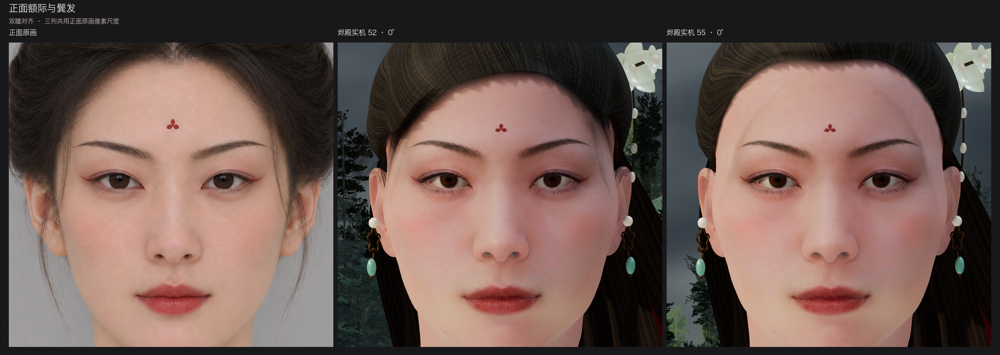
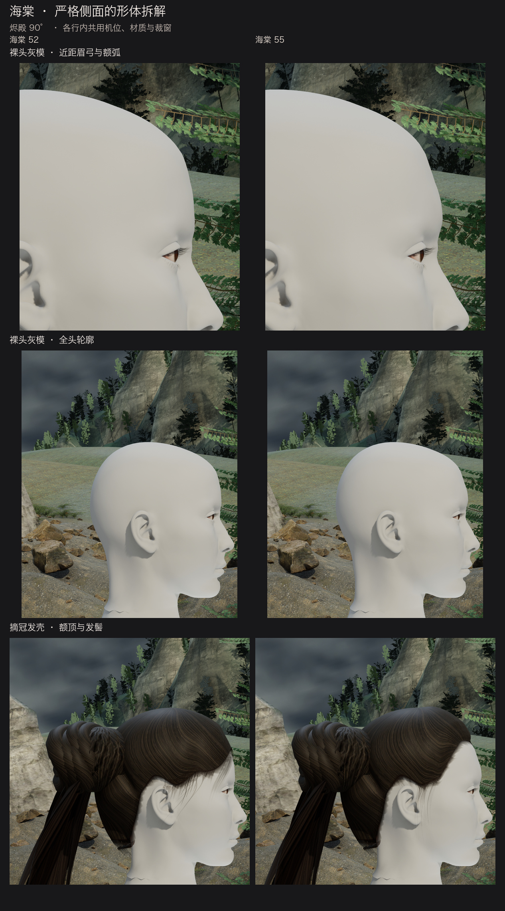
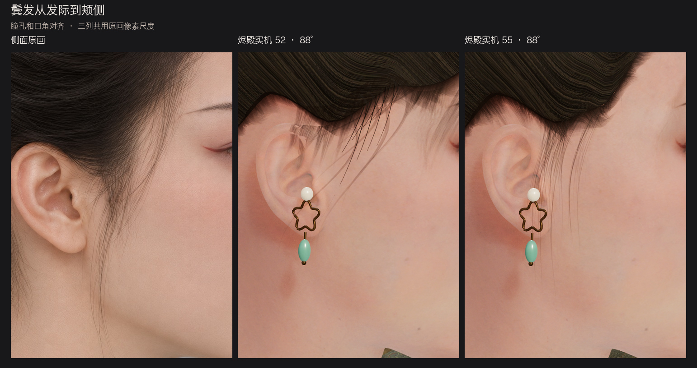
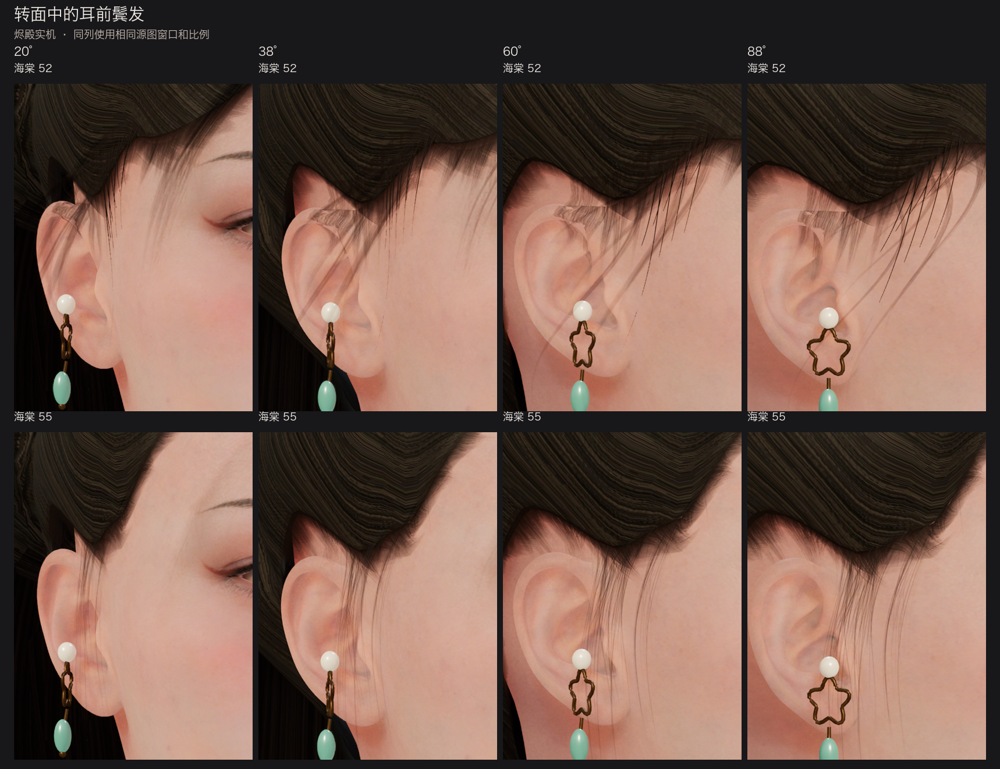

# 海棠 · 烬殿里的额顶与鬓丝

[烬殿实机转面，12 秒](orbit.mp4) · [耳前发根到发梢的跟拍近景，12 秒](temple-orbit.mp4)

两段影片都从 RTX 5080 上的 Unreal 游戏窗口录制。左边是 52 版，右边是 55 版。近景取自同一段实录，左右按对应的实拍帧配对。火焰、待机和曝光各自运行。



## 眉上、发际与额顶

以近侧瞳孔和口角对齐侧面原画与烬殿 88° 近景，保留均匀缩放。沿 31 个高度测量裸额皮肤和背景交界，到原画外缘的距离中位数从 4.5 个像素降到 1.5 个像素。独立取正式网格的侧面截线，相应距离从 3.94 降到 2.6 个像素，单位均为 1254 × 1254 原画中的像素。

以九条纵线取样，额角发际露出连续皮肤的位置与原画相差的中位数由 137 降到 2 个像素。发际上方另取八个高度，前额顶部头发外缘的误差中位数从 20.5 降到 2.5 个像素。



新的头部网格把眉上中央略向前补，再把上额收向发际。额角的前发际顺着眉尾上方斜向耳前，头发在额顶的外弧也随之调整。原画裁到了头顶，可对照的范围截至画面上缘。游戏里的礼冠和后发髻另有自己的体积。







灰模图使用两版正式角色，锁定同一个待机动画在 0.24 秒。逐行使用同一取景。摘冠保留发壳，去发则显示下面的头部网格。

## 耳前细发

发际的短绒沿头皮倾倒。较长的两束在耳前分开，卡片上每根丝分别收细、渐隐。新露出的额角恢复了原有的扫描皮肤纹理，正面原画中的旧鬓发有单独的投影遮罩。

在 88° 实机耳前放置七条相同的横向采样线。沿发丝方向连续、与皮肤反差较强的交点由 15 个变为 0 个，较柔和的交点由 29 个变为 40 个。对齐的原画上分别测到 0 个和 66 个。每根长丝可以与多条采样线相交。





[机位、参考点和测量读数](measurements.json)

在 Windows 项目根目录运行下列命令，可以复看转面和定点镜头。

```powershell
.\Scripts\play_pilgrimage.ps1 -CheekStudy -HeadStudy -Turntable
```
