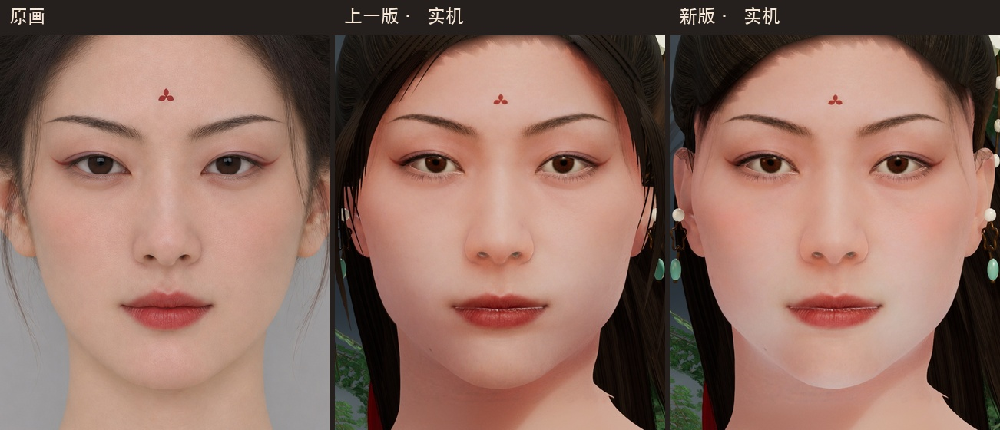
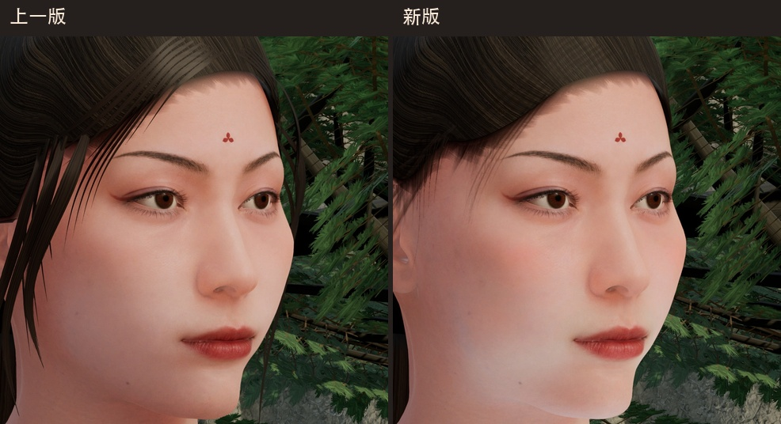
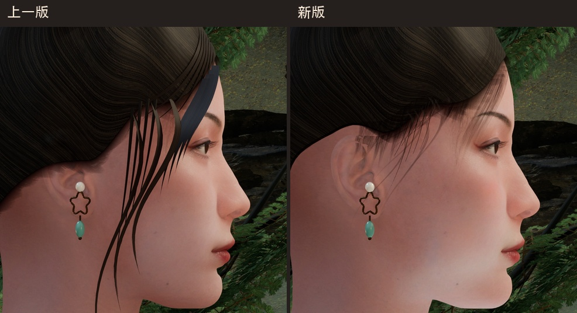
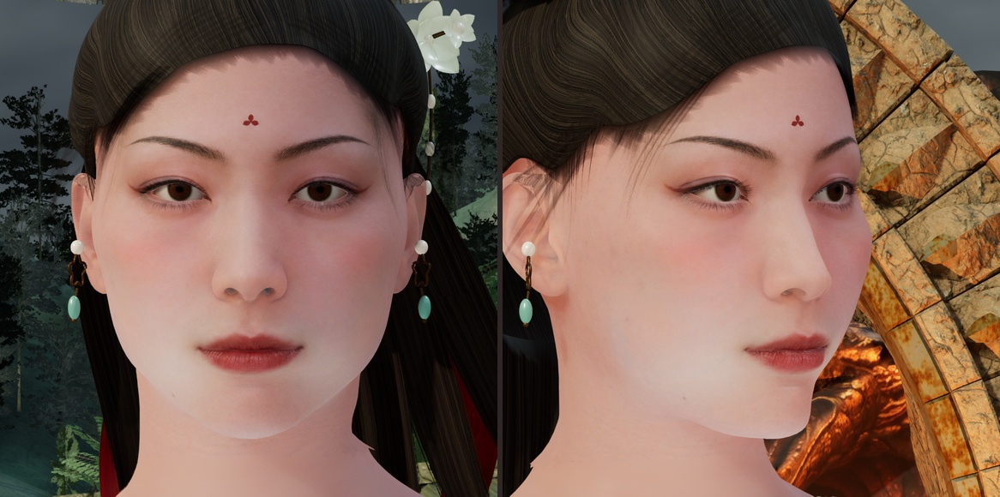

# 海棠的下颌阴影、颊色与鬓角

[两版实机同步转面 · 12.6 秒](orbit.mp4)。左侧为上一版，右侧为新版。两段都是 RTX 5080 上相同钟楼机位的可玩角色录像，按眼鼻区的运动对齐起始帧。两边使用同一裁切和播放速度。

第一轮将耳前的宽发片拆成四组不等长的渐隐发丝，并从配准原画提取颊面的局部色差。转到侧面时宽黑带消失了，但耳前露出了平切的发壳。钟楼里的下颌侧面有所回亮，颏底下方仍有偏红的深影。第二轮扩大了发际贴合头皮的区域，用两层短绒发衔接发根，降低了颧前暖色的峰值。第二轮模拟象牙色衣领的漫反射，喉部回亮，颏尖和唇周却被照得过白。

第三轮逐层隐藏侧面发片，确认绕头的发根片穿进了耳廓，随后缩短了耳上这一段。六组衣领反光实拍用来比较位置与强度。第三轮用窄光束保住了颏尖色泽，但颏下两个采样点仍然很暗。射线检查确认两点都命中头部网格上的颈皮。第四轮沿用已通过评审的发根和颊色，将短程漫反射置于更低的位置，以动画头骨为定位基准。近景实测定位与校准位置一致，柔光随距离衰减。

| 固定机位的明度 L* | 原画 | 上一版 | 新版 |
| --- | ---: | ---: | ---: |
| 下颌侧面 | 68.5 | 58.3 | 72.4 |
| 颏底下方 0.08 瞳距 | 59.0 | 41.3 | 60.0 |
| 颏底下方 0.13 瞳距 | 62.0 | 42.4 | 59.1 |

颏底位置取正面窄条中最明显的亮度下降，下面两组数值取距颏底相应距离的皮肤中位色；下颌侧面按双瞳配准取双侧读数。场景灯光会影响这些显示色。[完整 Lab 读数](measurements.json)

独立角色评审在钟楼与烬殿逐项复核了颏下柔光、颊部色差和鬓角的转面。烬殿 38° 的颏尖下缘仍略偏冷；颏底更深处的肤色比原画偏红，极近看耳后发壳的边线也更齐整。

在 Windows 本地项目运行 `native\Scripts\play_pilgrimage.ps1 -PortraitReview` 可检查正面、闭眼、38°、88°和张口。使用 `-ShrinePortrait` 可检查烬殿的斜光。
