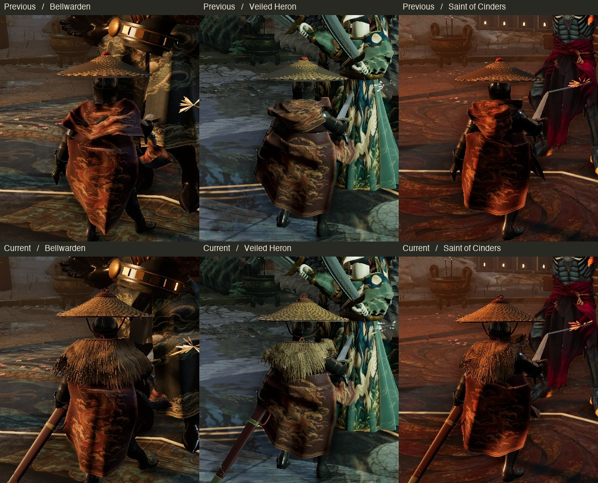

# The pilgrim's rain gear in combat

Both rows follow the same light-attack input, approach and lock-on camera on Penitent. The upper row uses revision `53b566c`, the lower row uses `03889d2`. The crops come from 1920 × 1080 gameplay in Chrome on an Apple M1 Max. The original images preserve the full combat camera.

[Bellwarden](belfry.jpg) · [Veiled Heron](garden.jpg) · [Saint of Cinders](reliquary.jpg) · [Lateral dodge and recovery](dodge.jpg)

Four courses of split palm fibre are sewn over the shoulder cloth. The woven neck cord and overlapping blades follow the cloth as the arms lift and the pilgrim turns. The bamboo hat has a lining fitted to the curved crown, a bound rim, dyed cord and ties behind the neck. The red-lacquer case hangs at the left hip, with a recessed throat and bronze fittings. Its suspension follows the hips rigidly. The exposed helmet and lower legs retain their smooth metal surfaces.

[Continuous Bellwarden fight with stereo game audio](duel.mp4) · [Victory readback](duel.json)

The recorded fight ends after three parries and the awakened phase. The video is 28 seconds long and contains the complete exchange through the victory screen. A separate Pilgrim playthrough and three Penitent retries exercised the remaining chapter flow.

[Chapter clear results](clears.json) · [Defeat and retry results](retries.json) · [CI for the playable build](https://github.com/lzongren/vesper-hollow-tide/actions/runs/43599319947)
