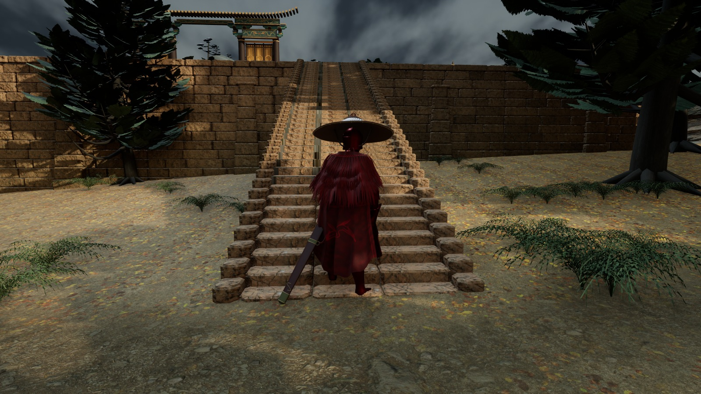
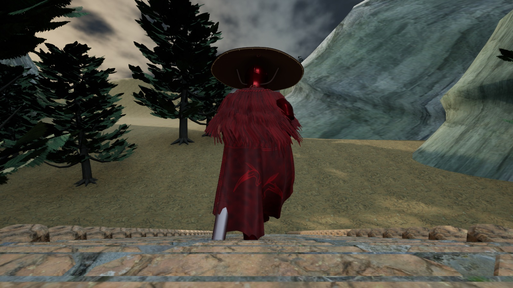
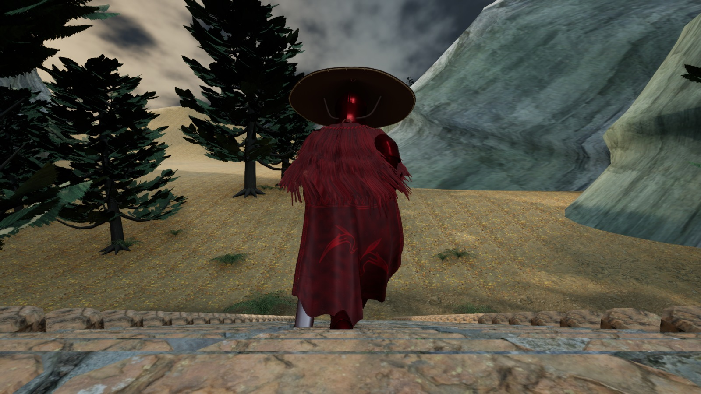
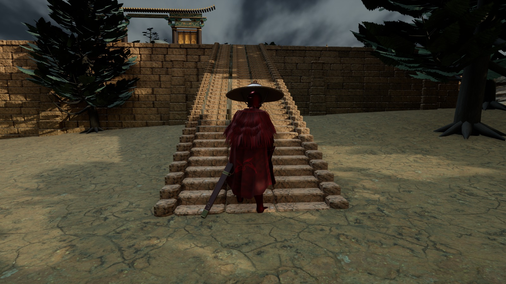
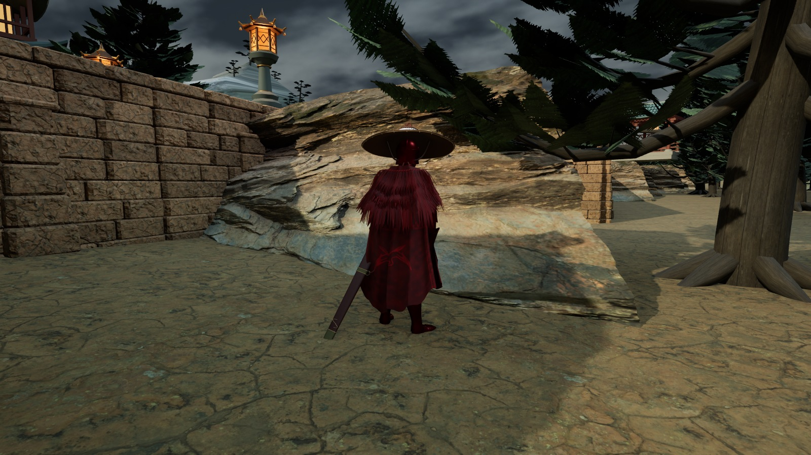
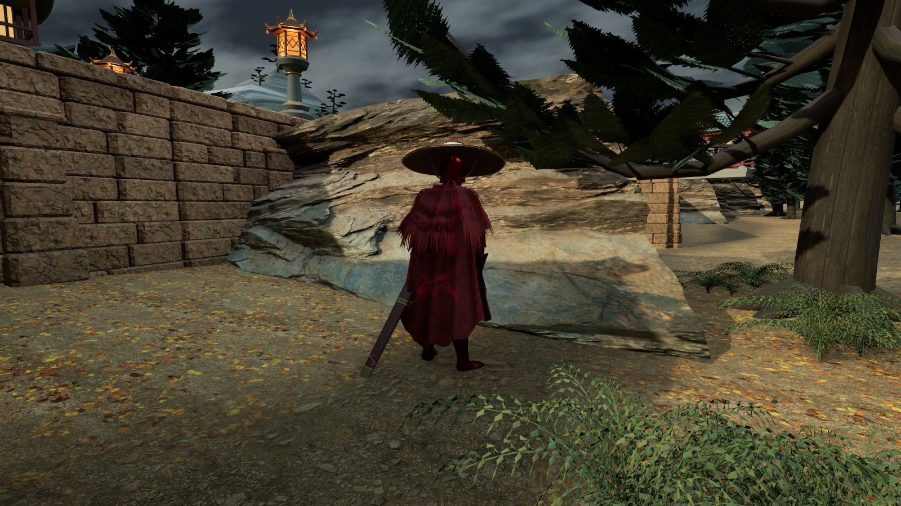

# Under the mountain causeway

| Camera | Previous floor | Dressed floor |
| --- | --- | --- |
| Descending |  |  |
| At the landing |  |  |
| Below the retaining wall |  |  |

The five screenshots came from the possessed traveller in standalone Unreal Engine 5.8.4 on an RTX 5080 at 1600 × 900. The earlier and updated maps share their lighting, stair collision, player input and camera headings. A 432-metre world-space control map places walked soil at the three stair exits, blends leaf litter into the clearings and lowers rock roughness in the valley drainage. The two 2K ground scans include per-layer colour, normal and roughness. The foliage pass places 313 original fern rosettes in clusters on the actual terrain triangles, with clearance along all three stair flights.

The first stair round trip ended back in the court. Both passes recorded zero falling-mode samples. At the bank, the stationary player camera ran under a 60 fps cap for eight seconds without screenshots. Across 477 intervals the median game tick was 16.66 ms, the 95th percentile was 17.58 ms and the longest was 23.66 ms. This sample excludes combat.

[Route telemetry](route.json) · [Ground and plant inventory](ground.json) · [Poly Haven Forest Floor](https://polyhaven.com/a/forest_floor) · [Poly Haven Forest Ground 04](https://polyhaven.com/a/forest_ground_04)
