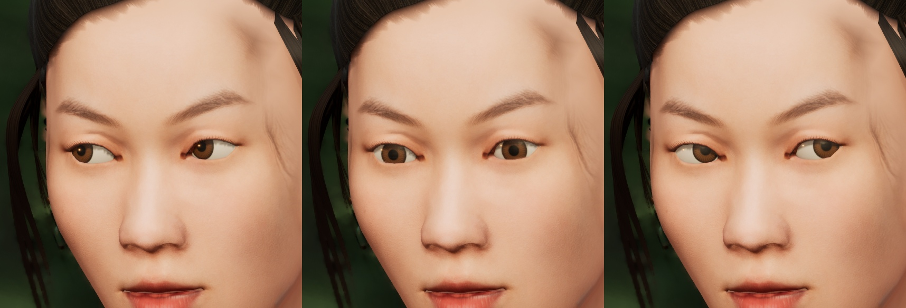

# 海棠 · 临阵目光

守钟人从海棠面前横过时，她会用双眼追踪他；他退到身后，她的目光回到前方。上图按画面中的视线方向排列。测试固定了身体姿态，保留正常游戏的目标检测、眼睑和材质更新。[连续追视和眨眼，7.5 秒无声窗口录像](follow.mp4) · [四次取样的朝向和材质参数](gaze.json) · [复现机位](../../../native/Scripts/probe_wayfarer_gaze.py)

| 守钟人的位置 | 完整的 2560 × 1440 游戏画面 |
| --- | --- |
| 身后 | [目光回正](neutral.jpg) |
| 海棠左前方 | [向左追视](left.jpg) |
| 海棠右前方 | [向右追视](right.jpg) |
| 再次退到身后 | [解除追视](released.jpg) |

虹膜沿独立眼球的曲面转动，角膜上的反光随视角变化。视线跟随动画里的头部朝向，有遮挡、目标离开视野或阵亡后会解除追视。三场战斗共用这套行为。鼻翼、脸颊、眼睑和唇部现在有不同的微表面法线和粗糙度；原来的肤色与骨相得以保留。[相同机位的上一版皮肤](previous-skin.jpg) · [贴图生成与模型来源](../../../native/Art/Wayfarer/)

## 从山门到灰烬祠

在 RTX 5080、Unreal Engine 5.8.4、2560 × 1440 和 60 帧上限下，关闭录像与截图，用自动输入走完全程。自起点计时，海棠在 21.90、61.15 和 100.96 秒依次击败三名 Boss。约每四分之一秒抽样一次，分别有 53、83 和 73 个样本记录到她正注视对应的对手。[实战角色、血量与目光记录](three-courts.json)

Unreal CSV Profiler 记录了 5,757 帧。中位帧时间为 16.81 毫秒，P95 为 19.86 毫秒，P99 为 23.60 毫秒。18 帧超过 33.33 毫秒，其中首帧耗时 699.40 毫秒，第 15 帧为 141.39 毫秒，约第 55.1 秒还有一帧为 105.85 毫秒。[逐帧 CPU 与 GPU 时间](frame-times.csv)

另一次窗口录像保留了三场交手和同次运行的引擎混音。录制时的自动操作在第三庭剩 9 点 Boss 血量时连续挥空，最终超时。给测试输入加入持续未命中时后撤再进身的动作后，另一次完整游玩在 103.18 秒击败灰烬圣徒；这一趟没有触发后撤条件，因此还不能断定原先的卡位已经解决。[重跑通关记录](repeat-courts.json)

[27 秒三场交手节选](three-courts.mp4) · [守钟人](Bellwarden.jpg) · [披纱鹭](VeiledHeron.jpg) · [灰烬圣徒](CinderSaint.jpg) · [录像这趟的战斗记录](recorded-courts.json)

## 战斗距离下的差距

在守钟人庭院，剑和出招方向清楚，灯笼与地砖在中远景的亮度却较为接近。海棠靠近守钟人时，两人的轮廓也容易叠在一起。PlayStation 公开的手杖对峙截图里，近处猎人的暗衣、侧光照亮的武器和远处暖灯各占不同的明暗范围。城堡廊内那张图则用窗光把可行走的纵深划了出来。这次眼神和皮肤的改动在近景可见，庭院仍需要这样的光影层次。[本作庭前实景](approach.jpg) · [PlayStation 官方截图与原文](https://blog.playstation.com/2014/11/20/new-bloodborne-weapon-and-hunter-emerge/)
