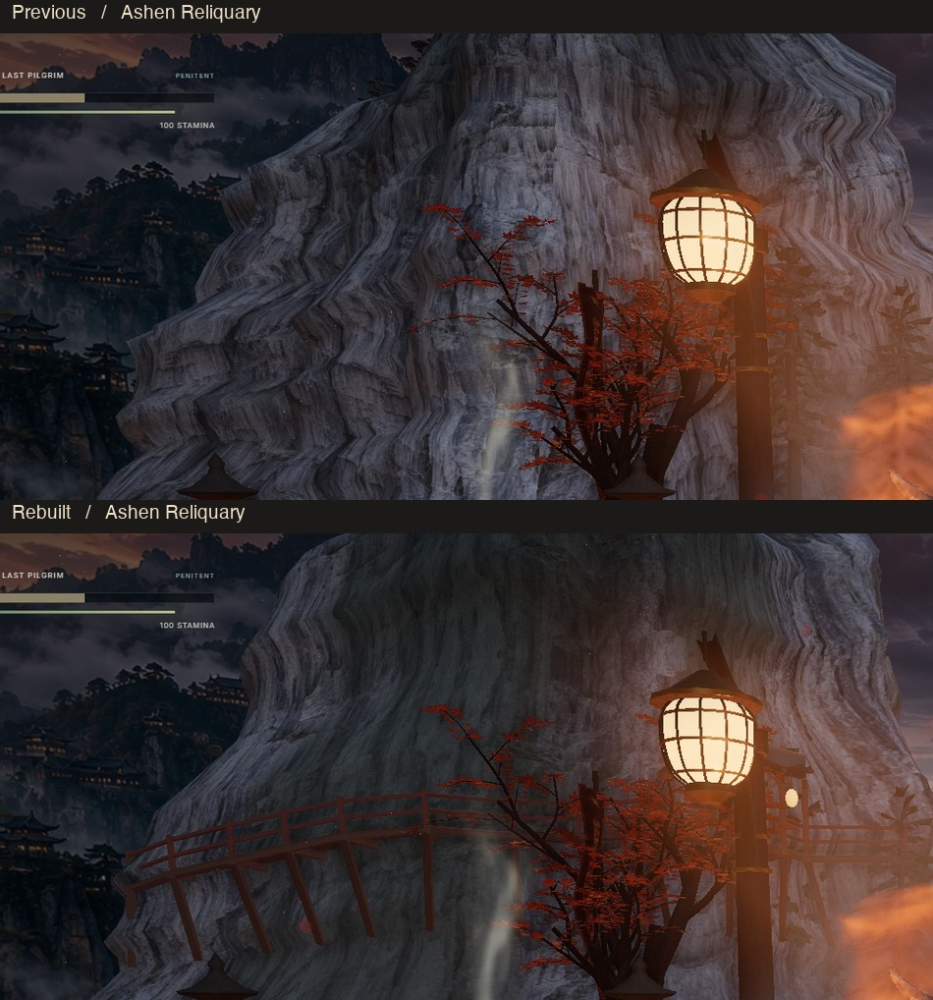

# The west cliff path

Both crops come from 2560 × 1440 Edge gameplay on the same Windows RTX 5080. The camera, inputs, attack and simulation step match. The original frame is from build `ec1794d`. The rebuilt frame is from `a5000e9`. The third encounter finished the capture pose with 18 health in both builds. [Previous full frame](../shrine-fire/rtx5080/release.jpg) · [Rebuilt full frame](shrine.jpg)

The shrine's west path uses two rows of actual rock vertices for its deck and diagonal supports. The footway turns back into the cliff at both ends. The shelter has projecting eaves and two hanging lamps. It sits beyond the playable arena. The other courts share the new buttress geometry and eight individually weathered rock faces. The source bake draws the limestone detail, joints and mineral wash into a padded 4096 × 4096 atlas. The wall on the opposite side of the shrine retains its photogrammetry mesh. [Native shrine asset](../../../native/Art/ShrineCliffWalk.glb)

[Six seconds of lateral movement](crossing.mp4) follow the playable combat camera at 1920 × 1080. This silent shot samples one rendered frame per two simulation ticks with keyboard input. The full-size still above and the performance measurements were captured separately.

A real-time 1440p run on Pilgrim cleared all three awakened bosses in succession. The final chapter screen appeared with 75 health remaining. The 95th percentile intervals between browser animation callbacks during combat were 16.8 ms in each court. The longest observed intervals were 18.4, 22.5 and 75 ms respectively. [Outcomes, loading and combat intervals](clears.json)

All 82 local release files matched the Windows runtime and the Linux CI download by SHA-256. The macOS and Linux builds and Windows and Linux source-tool checks passed. [Build and test run](https://github.com/lzongren/vesper-hollow-tide/actions/runs/43610088868)
