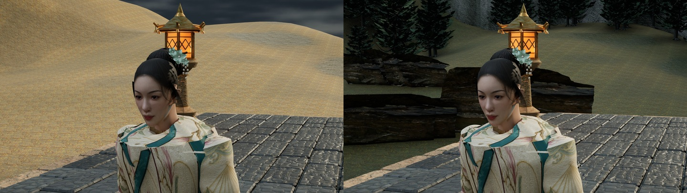

# Western mountain pass

The path into the first court previously faced a broad, straw-coloured slope. The revised pass has nine limestone spurs at different distances, 108 pines and 25 scanned outcrops. A 432-metre colour map varies the diffuse response of the existing ground scans across the valley and beneath the tree stands. The playable route uses the same collision surface.

[Original 1440p frame](../magnolia-wayfarer/after-front.jpg) · [Revised 1440p frame](after-front.jpg) · [Side view](after-profile.jpg) · [Walking toward the belfry](after-walk.jpg)

The first two frames use the same player, pose, location, lens and lighting on the RTX 5080. The overview cameras look across the west entrance, northern wall and southern court approach in the standalone Unreal Editor game. [West entrance](west.jpg) · [Northern wall](north.jpg) · [Southern approach](south.jpg)

In a continuous route trial from spawn the player defeated the Bellwarden at 21.88 seconds, the Heron at 59.86 seconds and the Saint at 100.24 seconds. [Traversal and combat trace](three-courts.json)
