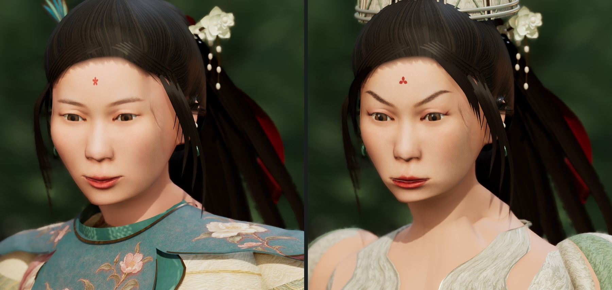

# 海棠的白无常装束

服装取形于《明末：渊虚之羽》公开展示的 White Spectre 套装。高冠的锥形、交叠的白衣和沿肩而下的长带来自这套参照。冠片、银丝、披帛、衣纹和面部都是为海棠重建的资产。[官方服装图](https://505games.com/wp-content/uploads/2025/04/Pre-order-bonuses.jpg)

| Unreal 游戏窗口 | 上一版 | 新版 |
| --- | --- | --- |
| 正面肩颈 | [原图](before-front.jpg) | [原图](after-front.jpg) |
| 偏侧面与颌线 | [原图](before-profile.jpg) | [原图](after-profile.jpg) |
| 同机位全身 | [原图](before-dress.jpg) | [原图](after-dress.jpg) |

[完整冠形](after-crown.jpg) · [包含冠顶和靴底的全身](after-silhouette.jpg)

两版均从同一山路位置、相同镜头与游戏内天光拍摄。近景对照仅作相同裁切。新版把脸部材质区域从 8,256 个三角面细分至 33,080 个，保留睫毛附着点与眨眼形变，重新塑了颌缘、颏部和嘴角。朱砂眼尾和唇色画在面部贴图上。肩上的丝片直接沿袖山和上臂曲面裁切，两处共用战斗骨骼的权重。颈部与锁骨从头像底部的 92 个边缘顶点延伸到交领，接缝两侧共用顶点位置和骨骼权重。披帛回绕后颈。动作近景取自正常输入触发的 AM_ComboAttack，抬剑和挥剑分别截在动画的约 0.10 秒和 0.34 秒。

[持剑时的肩形](lift.jpg) · [出剑时的肩形](cut.jpg) · [守钟人实战录像](bell-duel.mp4) · [守钟人](Bellwarden.jpg) · [披纱鹭](VeiledHeron.jpg) · [灰烬圣徒](CinderSaint.jpg) · [三场战斗记录](three-courts.json)

守钟人录像约 10 秒，采集自 1600 × 900 的游戏输出及同一进程的立体声音频。回放以实际呈现的第一帧对齐战斗截图，再用七次血条变化核对时间。
