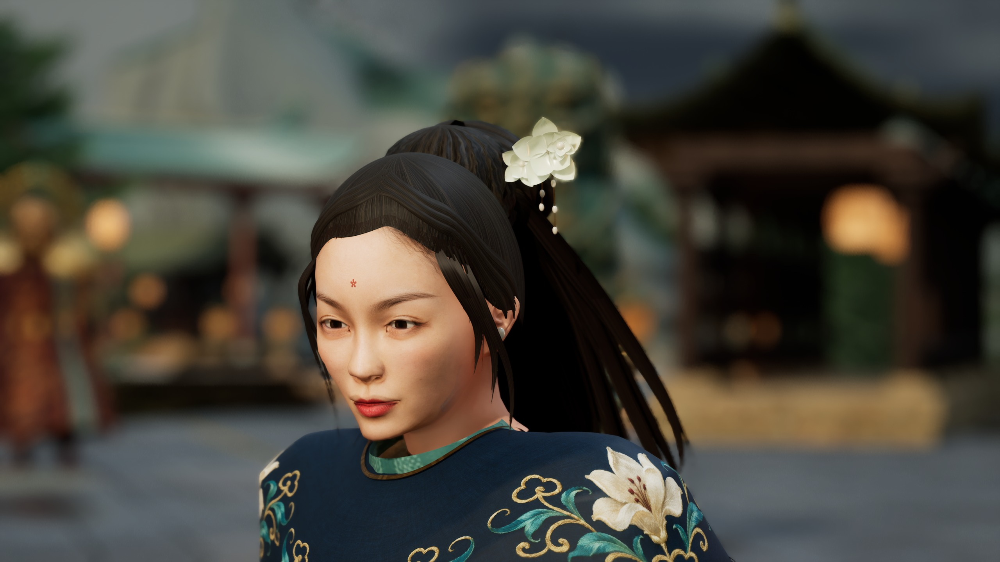

# 玉兰女侠

女主角将长发半挽在脑后，鬓侧簪着一枝白玉玉兰，两串珍珠垂在花下。眉间保留朱砂梅花。象牙色绣衣的前后各留一片完整花面，青绿色褶裙从两侧展开，露出绛红滚边。背后的长发分别跟随头、颈和肩部骨骼。

| 实机视角 | 上一版 | 玉兰女侠 |
| --- | --- | --- |
| 庭前近景 | [梅妆与蝶簪](../plum-wayfarer/courtyard.jpg) | [玉兰花簪与鬓发](courtyard.jpg) |
| 持剑全身 | [旧裙装](../plum-wayfarer/after-profile.jpg) | [青绿侧褶与象牙色裙面](profile.jpg) |
| 战斗背面 | [旧发髻](../plum-wayfarer/after-rear.jpg) | [半挽长发](rear.jpg) |

两组近景使用相同的庭院机位与景深。画面取自 RTX 5080 上运行的 Unreal Engine 5.8.4 独立游戏窗口，原始截图为 2560 × 1440。眼球使用独立的栗色虹膜，眼睑保留原有眨眼动画。[檐下近景](eaves.jpg) · [行走](walk.jpg) · [闭眼](blink.jpg) · [睁眼](portrait.jpg)

[角色美术来源与重建方法](../../../native/Art/Wayfarer/) · [启动游戏](../../../native/README.md)

## 三场实战

自动输入驱动同一个角色走完全程。首次录像里，她在第 23.88 秒击败守钟人，第 61.05 秒击败披纱鹭，第 98.94 秒击败灰烬圣徒。录像保留实际游戏窗口和同一趟运行的引擎立体声混音。

[完整实机录像](three-courts.mp4) · [守钟人](Bellwarden.jpg) · [披纱鹭](VeiledHeron.jpg) · [灰烬圣徒](CinderSaint.jpg) · [位置、血量与胜利记录](three-courts.json)
